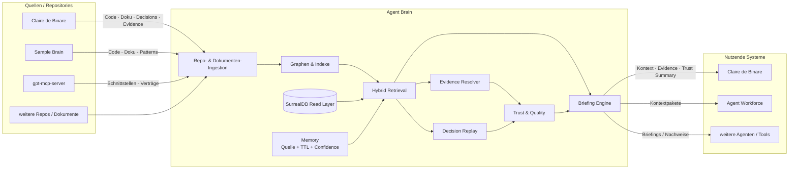
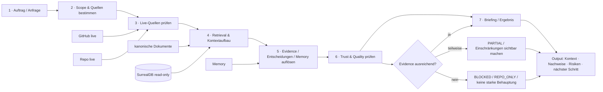
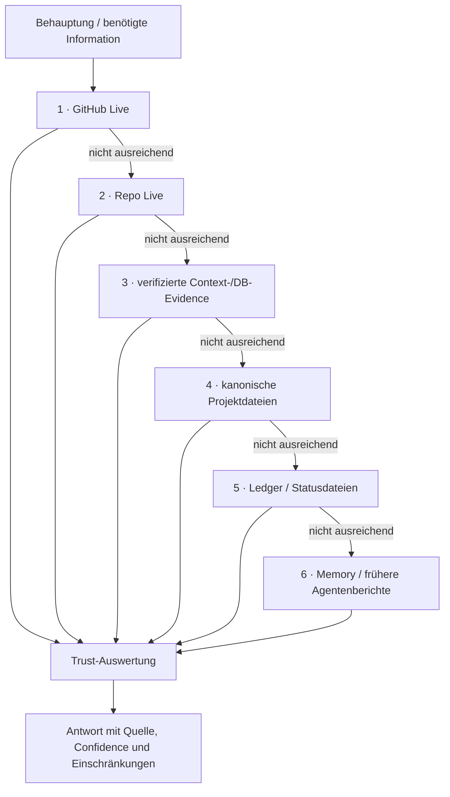
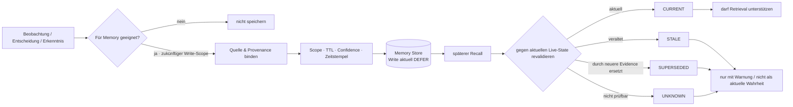
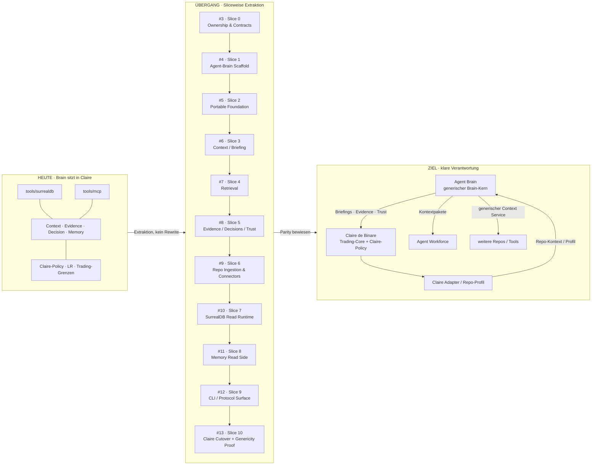
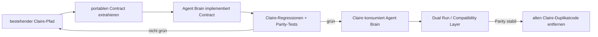
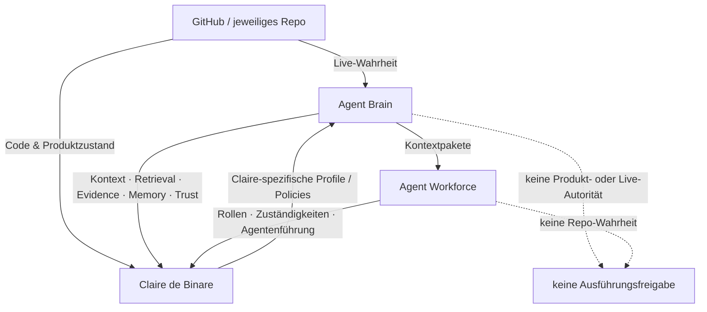
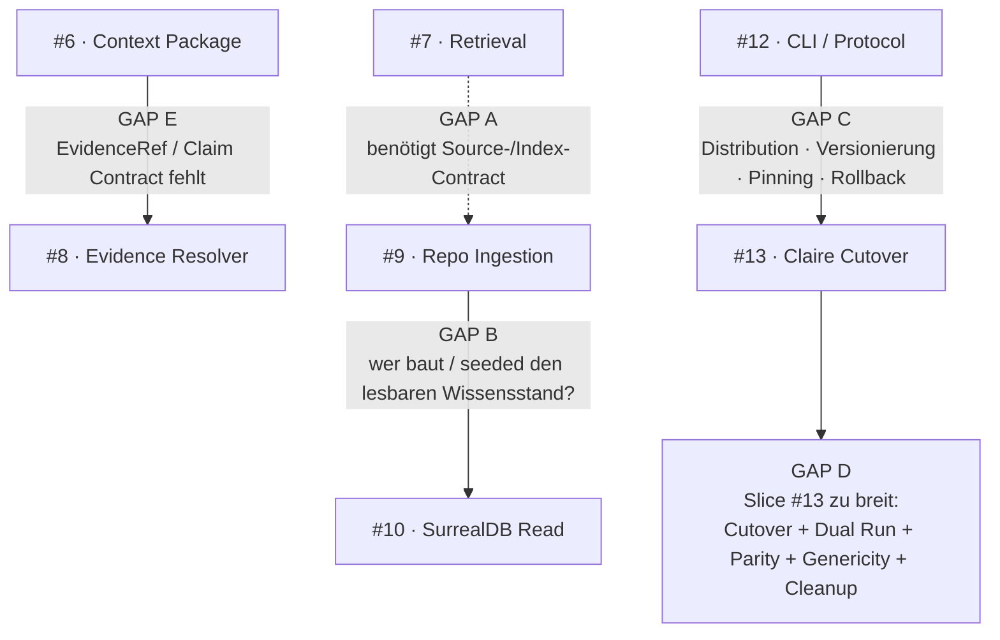

# Agent Brain — Datenflüsse

Diese Seite zeigt die wichtigsten Zusammenhänge als Mermaid-Diagramme. Ziel ist nicht technische Vollständigkeit, sondern schnelle Orientierung für den Operator.

**Operative Planung:** [Epic #2 — Agent Brain aus Claire de Binare extrahieren](https://github.com/jannekbuengener/agent-brain/issues/2)

---

## 1. Gesamtbild: Quellen → Agent Brain → Consumer

**Merksatz:** Das jeweilige Repository liefert die aktuelle Wahrheit. Agent Brain strukturiert, verbindet und erklärt diese Wahrheit für Agenten.

---

## 2. Laufender Auftrag: vom Auftrag zum belastbaren Ergebnis

### Typische Ergebnisklassen

- `DB_BACKED` — relevante Aussage ist durch echte DB-/Tool-Evidence gestützt.
- `PARTIAL` — Teile sind belegt, Teile bleiben eingeschränkt oder unklar.
- `REPO_ONLY` — belastbare Repo-/GitHub-Evidence, aber keine DB-gestützte Aussage.
- `BLOCKED` — die nötige Evidence fehlt oder widerspricht sich so stark, dass keine belastbare Aussage möglich ist.

---

## 3. Wahrheit und Evidence: was gewinnt bei Widerspruch?

**Grundregel:** Agent Brain darf niedrigere Ebenen nicht benutzen, um eine höhere, aktuellere Wahrheit zu überschreiben.

---

## 4. Memory-Lebenszyklus

**Wichtig:** Memory ist Wiederfindehilfe, keine Autorität. Ohne Quelle, Scope, TTL und Confidence gehört eine Information nicht in das dauerhafte Brain-Memory. Im aktuellen Extraction-Epic ist die **Read Side** enthalten; produktive Agent-Memory-Writes bleiben ausdrücklich `DEFER`.

---

## 5. Extraktion aus Claire de Binare: kontrollierter Cutover

### Direkte Issue-Links

| Slice | Issue |
|---|---|
| 0 · Extraction Canon | [#3](https://github.com/jannekbuengener/agent-brain/issues/3) |
| 1 · Scaffold | [#4](https://github.com/jannekbuengener/agent-brain/issues/4) |
| 2 · Portable Foundation | [#5](https://github.com/jannekbuengener/agent-brain/issues/5) |
| 3 · Context / Briefing | [#6](https://github.com/jannekbuengener/agent-brain/issues/6) |
| 4 · Retrieval | [#7](https://github.com/jannekbuengener/agent-brain/issues/7) |
| 5 · Evidence / Trust | [#8](https://github.com/jannekbuengener/agent-brain/issues/8) |
| 6 · Repo Ingestion | [#9](https://github.com/jannekbuengener/agent-brain/issues/9) |
| 7 · SurrealDB Read | [#10](https://github.com/jannekbuengener/agent-brain/issues/10) |
| 8 · Memory Read | [#11](https://github.com/jannekbuengener/agent-brain/issues/11) |
| 9 · CLI / Protocol | [#12](https://github.com/jannekbuengener/agent-brain/issues/12) |
| 10 · Claire Cutover | [#13](https://github.com/jannekbuengener/agent-brain/issues/13) |

### Cutover-Regel

**Kein Big Bang:** Altcode wird erst entfernt, nachdem der neue Pfad dieselben relevanten Verträge und Tests erfüllt.

---

## 6. Verantwortungsgrenzen im Zielbild

### Kurzform

- **GitHub / Repo:** Was ist aktuell wahr?
- **Agent Brain:** Was muss der Agent dazu wissen und wie belastbar ist dieses Wissen?
- **Agent Workforce:** Wer soll welche Arbeit unter welchen Zuständigkeiten erledigen?
- **Claire de Binare:** Welche produkt- und trading-spezifischen Regeln gelten für Claire?

---

## 7. Offene Gaps zwischen den Slices

Der aktuelle lineare Plan ist **noch nicht vollständig implementierungsreif**. Die folgenden Übergaben sind im [Epic #2](https://github.com/jannekbuengener/agent-brain/issues/2) als `OPEN_GAP` dokumentiert.

### Was vor Implementierung korrigiert werden muss

1. **GAP A:** Source-/Index-/Repo-Profile-Contract vor Retrieval stabilisieren oder Slice #9 aufteilen/vorziehen.
2. **GAP B:** Knowledge-/Index-Build-Writes sauber von produktiven Agent-Memory-Writes trennen und einen reproduzierbaren Build/Seed/Import-Pfad definieren.
3. **GAP C:** Consumer-/Release-Contract für Claire definieren — Versionierung, Pinning, Cross-Repo Contract Tests und Rollback.
4. **GAP D:** Slice #13 verkleinern, wenn Cutover-Vertrag feststeht.
5. **GAP E:** Minimalen `EvidenceRef`-/Claim-Referenzvertrag früh festlegen; Resolver/Scoring bleibt später in #8.

Diese Gap-Liste ist **kein zusätzlicher Produkt-Scope**, sondern die fehlende Verbindung zwischen bereits geplanten Verantwortungsbereichen.
