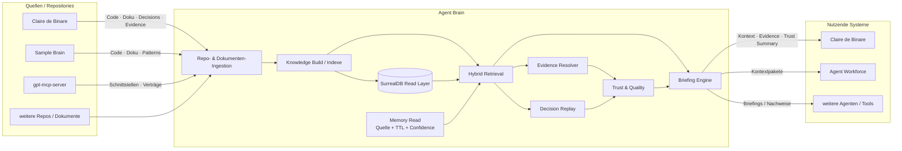
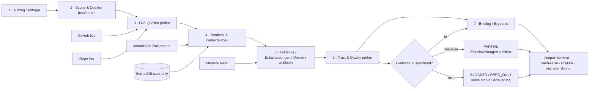
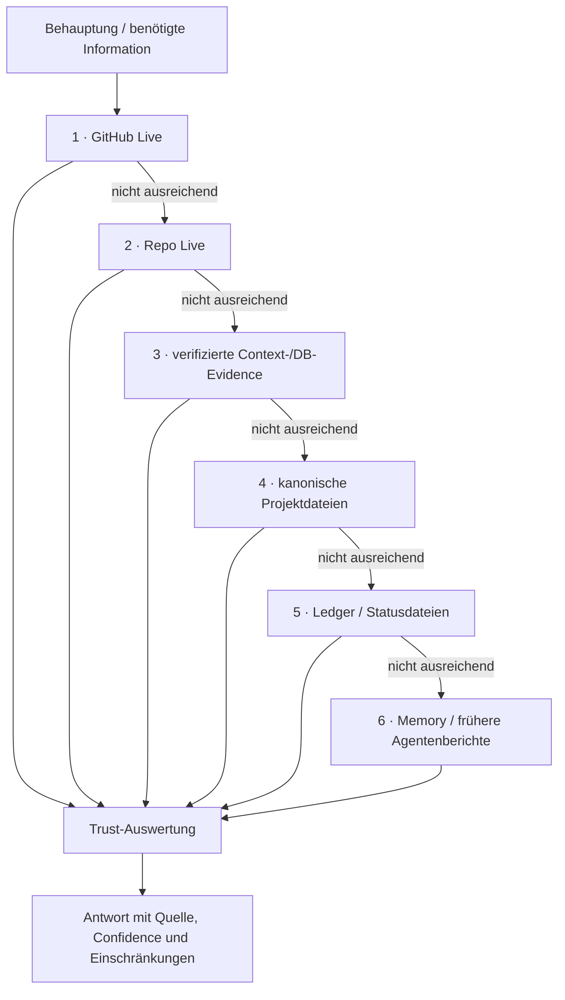
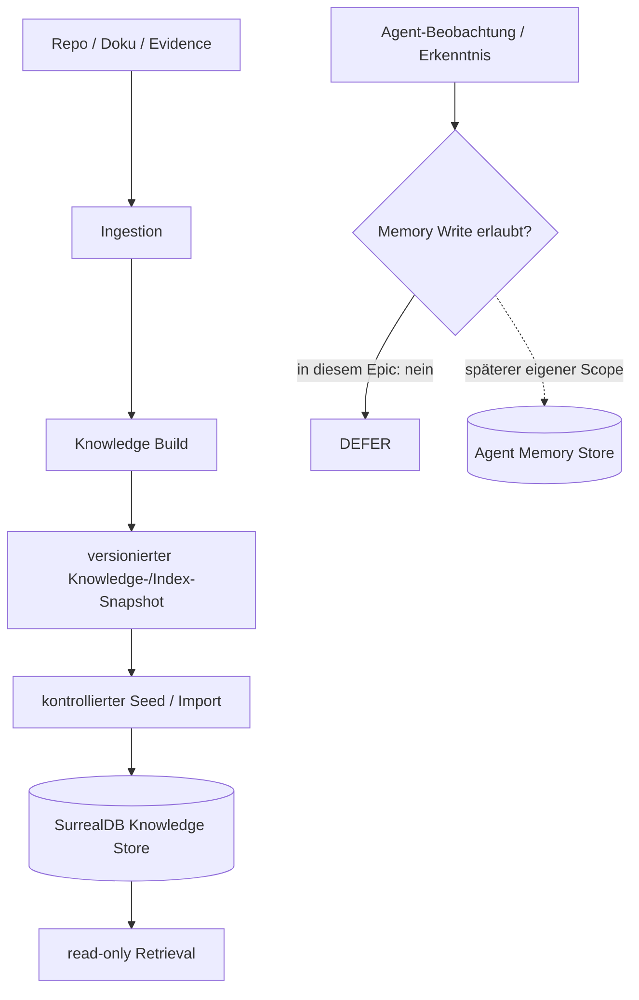
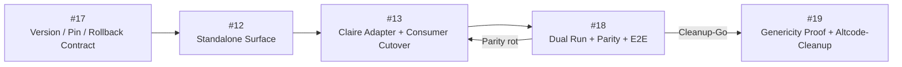
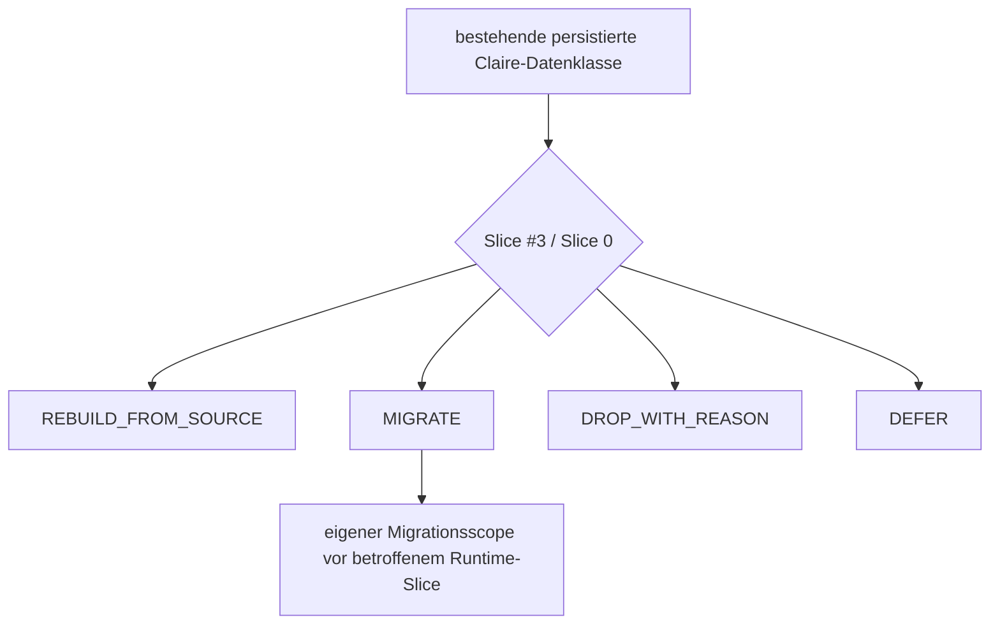
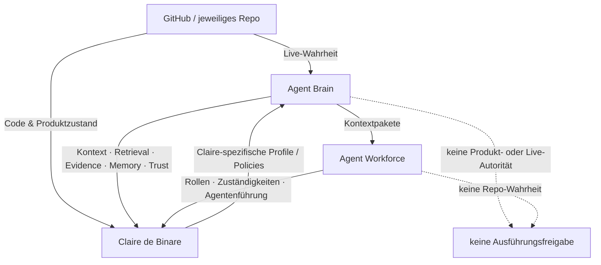

# Agent Brain — Datenflüsse

Diese Seite zeigt die wichtigsten Zusammenhänge als Mermaid-Diagramme. Ziel ist schnelle Orientierung für den Operator, nicht maximale Implementierungsdetailtiefe.

**Operative Planung:** [Epic #2](https://github.com/jannekbuengener/agent-brain/issues/2)

---

## 1. Gesamtbild: Quellen → Agent Brain → Consumer

**Merksatz:** Das jeweilige Repository liefert die aktuelle Wahrheit. Agent Brain strukturiert, verbindet und erklärt diese Wahrheit.

---

## 2. Laufender Auftrag: vom Auftrag zum belastbaren Ergebnis

Typische Ergebnisklassen: `DB_BACKED`, `PARTIAL`, `REPO_ONLY`, `BLOCKED`.

---

## 3. Wahrheitshierarchie

Niedrigere Ebenen dürfen höhere, aktuellere Wahrheit nicht überschreiben.

---

## 4. Zwei verschiedene Write-Klassen

Das war ein zentraler Gap im ersten Plan: **Knowledge Build** und **Agent Memory** sind nicht dasselbe.

### Regel

- **Knowledge-/Index-Build-Writes:** reproduzierbare Build-Artefakte; Slice [#16](https://github.com/jannekbuengener/agent-brain/issues/16).
- **Produktive Agent-Memory-Writes:** bleiben in diesem Epic `DEFER`.
- **Memory Read:** wird in Slice [#11](https://github.com/jannekbuengener/agent-brain/issues/11) extrahiert.

---

## 5. Extraction Roadmap v2

```mermaid
flowchart LR
    S0["0 · #3\nExtraction Canon"] --> S1["1 · #4\nScaffold"]
    S1 --> S2["2 · #5\nPortable Foundation"]
    S2 --> S3["3 · #15\nShared Contracts"]
    S3 --> S4["4 · #6\nContext / Briefing"]
    S4 --> S5["5 · #9\nRepo Ingestion"]
    S5 --> S6["6 · #16\nKnowledge Build / Seed"]
    S6 --> S7["7 · #7\nRetrieval"]
    S7 --> S8["8 · #8\nEvidence / Trust"]
    S8 --> S9["9 · #10\nSurrealDB Read"]
    S9 --> S10["10 · #11\nMemory Read"]
    S10 --> S11["11 · #17\nDistribution / Versioning"]
    S11 --> S12["12 · #12\nCLI / Protocol"]
    S12 --> S13["13 · #13\nClaire Cutover"]
    S13 --> S14["14 · #18\nParity / Dual Run"]
    S14 --> S15["15 · #19\nGenericity / Cleanup"]
```

### Direkte Issue-Links

| Slice | Issue |
|---|---|
| 0 · Extraction Canon | [#3](https://github.com/jannekbuengener/agent-brain/issues/3) |
| 1 · Scaffold | [#4](https://github.com/jannekbuengener/agent-brain/issues/4) |
| 2 · Portable Foundation | [#5](https://github.com/jannekbuengener/agent-brain/issues/5) |
| 3 · Shared Contracts | [#15](https://github.com/jannekbuengener/agent-brain/issues/15) |
| 4 · Context / Briefing | [#6](https://github.com/jannekbuengener/agent-brain/issues/6) |
| 5 · Repo Ingestion | [#9](https://github.com/jannekbuengener/agent-brain/issues/9) |
| 6 · Knowledge Build / Seed | [#16](https://github.com/jannekbuengener/agent-brain/issues/16) |
| 7 · Retrieval | [#7](https://github.com/jannekbuengener/agent-brain/issues/7) |
| 8 · Evidence / Trust | [#8](https://github.com/jannekbuengener/agent-brain/issues/8) |
| 9 · SurrealDB Read | [#10](https://github.com/jannekbuengener/agent-brain/issues/10) |
| 10 · Memory Read | [#11](https://github.com/jannekbuengener/agent-brain/issues/11) |
| 11 · Distribution / Versionierung | [#17](https://github.com/jannekbuengener/agent-brain/issues/17) |
| 12 · CLI / Protocol | [#12](https://github.com/jannekbuengener/agent-brain/issues/12) |
| 13 · Claire Cutover | [#13](https://github.com/jannekbuengener/agent-brain/issues/13) |
| 14 · Parity / Dual Run | [#18](https://github.com/jannekbuengener/agent-brain/issues/18) |
| 15 · Genericity / Cleanup | [#19](https://github.com/jannekbuengener/agent-brain/issues/19) |

---

## 6. Claire-Cutover ist jetzt dreistufig

**Kein Big Bang:** Cutover, Beweis und Cleanup sind getrennte Entscheidungen.

---

## 7. Persistierter Claire-State: Slice-0-Gate

Noch nicht jede bestehende Datenklasse muss automatisch migriert werden.

Damit wird Migration nur dort gebaut, wo sie tatsächlich nötig ist.

---

## 8. Verantwortungsgrenzen im Zielbild

### Kurzform

- **GitHub / Repo:** Was ist aktuell wahr?
- **Agent Brain:** Was muss der Agent dazu wissen und wie belastbar ist dieses Wissen?
- **Agent Workforce:** Wer soll welche Arbeit unter welchen Zuständigkeiten erledigen?
- **Claire de Binare:** Welche produkt- und trading-spezifischen Regeln gelten für Claire?

---

## 9. Gap-Status

Die ursprünglichen Gaps A–E sind in **Roadmap v2** auf Planungsebene geschlossen:

- GAP A → #15 + #9 + #16 vor Retrieval.
- GAP B → #16 Build/Seed; #10 bleibt read-only.
- GAP C → #17 Distribution/Versionierung/Pinning/Rollback.
- GAP D → #13, #18 und #19 getrennt.
- GAP E → #15 definiert `EvidenceRef`/`ClaimRef`; #8 resolvt/scored später.

Offen bleibt bewusst nur **WATCH F**: bestehender persistierter Claire-State wird in Slice #0 klassifiziert.
