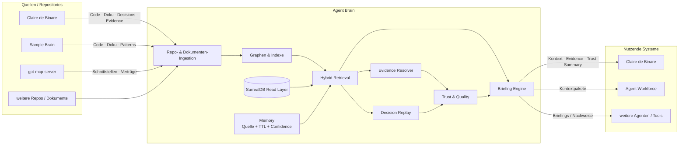
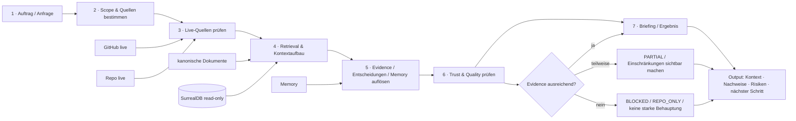
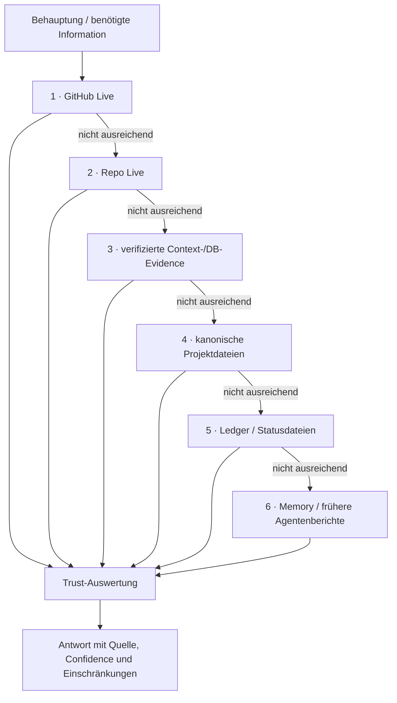
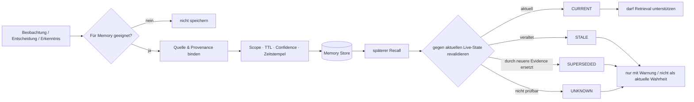
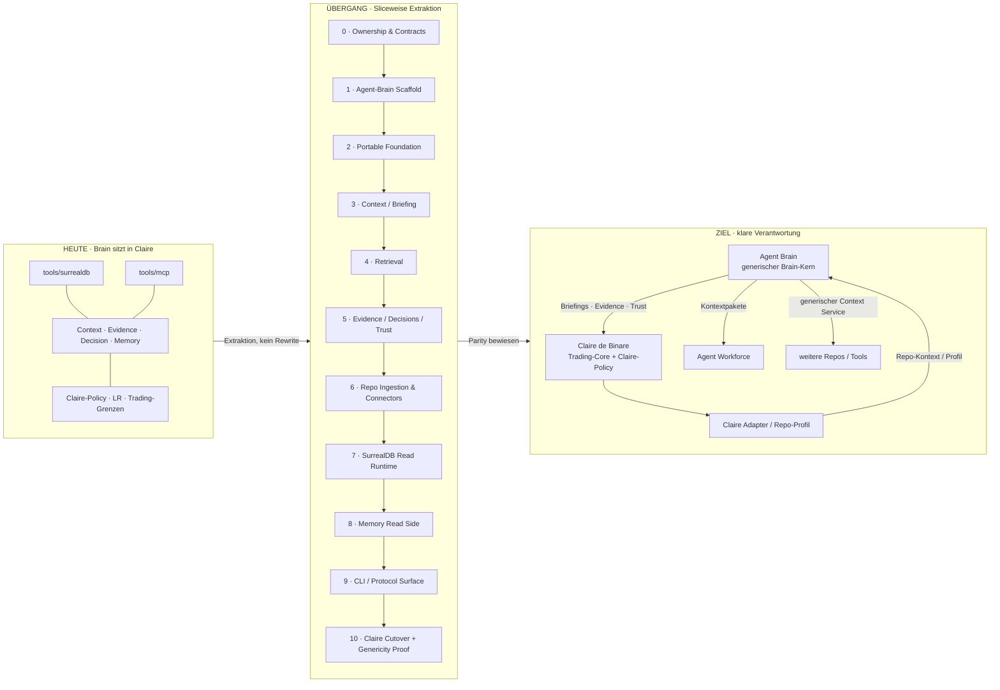
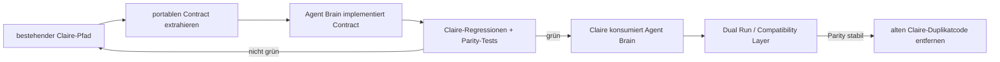
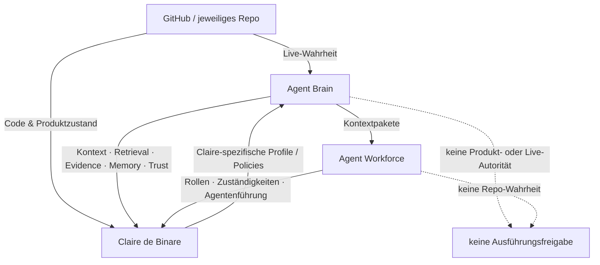

# Agent Brain — Datenflüsse

Diese Seite zeigt die wichtigsten Zusammenhänge als Mermaid-Diagramme. Ziel ist nicht technische Vollständigkeit, sondern schnelle Orientierung für den Operator.

---

## 1. Gesamtbild: Quellen → Agent Brain → Consumer

**Merksatz:** Das jeweilige Repository liefert die aktuelle Wahrheit. Agent Brain strukturiert, verbindet und erklärt diese Wahrheit für Agenten.

---

## 2. Laufender Auftrag: vom Auftrag zum belastbaren Ergebnis

### Typische Ergebnisklassen

- `DB_BACKED` — relevante Aussage ist durch echte DB-/Tool-Evidence gestützt.
- `PARTIAL` — Teile sind belegt, Teile bleiben eingeschränkt oder unklar.
- `REPO_ONLY` — belastbare Repo-/GitHub-Evidence, aber keine DB-gestützte Aussage.
- `BLOCKED` — die nötige Evidence fehlt oder widerspricht sich so stark, dass keine belastbare Aussage möglich ist.

---

## 3. Wahrheit und Evidence: was gewinnt bei Widerspruch?

**Grundregel:** Agent Brain darf niedrigere Ebenen nicht benutzen, um eine höhere, aktuellere Wahrheit zu überschreiben.

---

## 4. Memory-Lebenszyklus

**Wichtig:** Memory ist Wiederfindehilfe, keine Autorität. Ohne Quelle, Scope, TTL und Confidence gehört eine Information nicht in das dauerhafte Brain-Memory.

---

## 5. Extraktion aus Claire de Binare: kontrollierter Cutover

### Cutover-Regel

**Kein Big Bang:** Altcode wird erst entfernt, nachdem der neue Pfad dieselben relevanten Verträge und Tests erfüllt.

---

## 6. Verantwortungsgrenzen im Zielbild

### Kurzform

- **GitHub / Repo:** Was ist aktuell wahr?
- **Agent Brain:** Was muss der Agent dazu wissen und wie belastbar ist dieses Wissen?
- **Agent Workforce:** Wer soll welche Arbeit unter welchen Zuständigkeiten erledigen?
- **Claire de Binare:** Welche produkt- und trading-spezifischen Regeln gelten für Claire?
