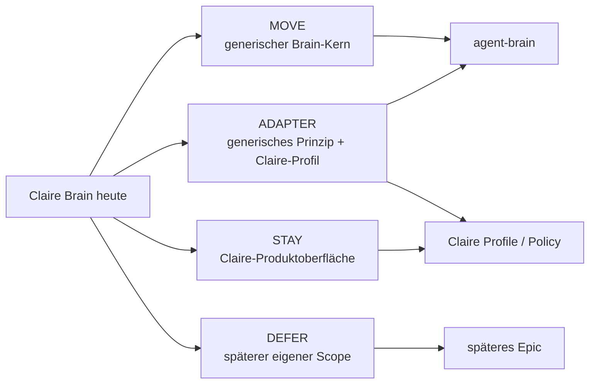

# Komponenten-Ownership — Claire → Agent Brain

**Status:** kanonisches Ergebnis von Slice 0 / #3  
**Source Baseline:** `Claire_de_Binare@84b5e05765fcde402a2565aa37fd42081ee95355`

## 1. Entscheidung in Kurzform

Der bestehende Brain-Code wird **nicht als Ordner `tools/surrealdb` kopiert**. Die Domäne wird entlang ihrer Verantwortlichkeiten getrennt.

## 2. `tools/surrealdb` — vollständige Datei-Zuordnung

Beim Audit wurden **78 Python-Dateien** unter `tools/surrealdb` erfasst. Jede Datei ist unten genau einer primären Ownership-Gruppe zugeordnet.

### 2.1 MOVE — Foundation / gemeinsame Basistypen

**Zielslice:** #5 / Slice 2 oder #15 / Slice 3

| Datei | Entscheidung | Ziel / Hinweis |
|---|---|---|
| `__init__.py` | MOVE | neue Paketgrenze, nicht blind kopieren |
| `gen_run_id.py` | MOVE | portable deterministische Utility |
| `sensitive_output.py` | MOVE | generische Redaction/Safety-Utility |
| `context_graph_contract.py` | MOVE | Shared Contract #15 |
| `db_record_evidence_contract.py` | MOVE | Shared Evidence Contract #15 |
| `db_record_evidence_response.py` | MOVE | Shared Evidence Response #15 |

### 2.2 MOVE — Context Package / Briefing Core

**Zielslice:** #6 / Slice 4

| Datei | Entscheidung | Hinweis |
|---|---|---|
| `context_package_v2.py` | MOVE | side-effect-free; Clock/Canonical-JSON entkoppeln; Claire-LR-Texte werden Policy-Overlay |
| `context_self_explanation.py` | MOVE | generische Explainability |
| `context_validation_plan.py` | MOVE | generische Validation-Plan-Logik |

### 2.3 ADAPTER — Repo-spezifische Context-/Readiness-Logik

Die Logik ist teilweise wiederverwendbar, konkrete Claire-Pfade/Required Reads/Guardrails bleiben außerhalb des Brain-Kerns.

| Datei | Entscheidung | Ziel |
|---|---|---|
| `context_required_reads.py` | ADAPTER | Resolver-Prinzip nach Agent Brain; Claire Read-Katalog bleibt Claire-Profil |
| `context_certify.py` | ADAPTER | generischer Check möglich; Claire-Certification bleibt Consumer-/Adoption-Surface |
| `context_onboarding_doctor.py` | ADAPTER | generischer Doctor + Claire-spezifische Checks trennen |
| `agent_os_readiness.py` | ADAPTER | Health-Logik generisch; harte Claire Required Reads/LR-Texte bleiben Claire-Profil |

### 2.4 MOVE NACH GENERALISIERUNG — Repository Ingestion

**Zielslice:** #9 / Slice 5

| Datei | Entscheidung | Claire-Kopplung, die entfernt werden muss |
|---|---|---|
| `context_indexer.py` | ADAPTER → MOVE | `core.utils.clock`, Claire Default-Config, lokale Modulpräfixe, Trading-State-Pfade |
| `ledger_importer.py` | ADAPTER → MOVE | Git-/Ledger-Pfade und Clock entkoppeln |

Der Indexer bleibt offline und ist bereits prinzipiell geeignet: Er öffnet keine DB und mutiert keine Runtime. Claire-spezifische Include/Exclude-Regeln werden zu einem **RepositoryProfile**.

### 2.5 MOVE — Knowledge Build / Seed / Schema

**Zielslice:** #16 / Slice 6

| Datei | Entscheidung | Hinweis |
|---|---|---|
| `context_importer.py` | ADAPTER → MOVE | Default dry-run und lokale Apply-Gates übernehmen; Agent-Memory-Import aus Build-Pfad herauslösen |
| `knowledge_refresh_cli.py` | MOVE | Knowledge-Rebuild-Orchestrierung |
| `knowledge_refresh_report.py` | ADAPTER → MOVE | generischer Refresh-Bericht; Claire-Readiness-Inputs entkoppeln |
| `local_reset.py` | MOVE | nur klar abgegrenzte lokale/dev Stores |
| `local_schema_apply.py` | MOVE | lokales Schema-Bootstrap, kein produktiver Default |
| `local_schema_check.py` | MOVE | Schema-Kompatibilitätsprüfung |
| `schema_snapshot.py` | MOVE | versionierter Schema-/Snapshot-Contract |

### 2.6 MOVE — Retrieval / Knowledge Reasoning

**Zielslice:** #7 / Slice 7

| Datei | Entscheidung | Hinweis |
|---|---|---|
| `context_impact_radar.py` | MOVE | produktneutrale Impact-Auswertung |
| `context_stop_resolver.py` | MOVE | generische Stop-/Readiness-Auswertung ohne Produktfreigabe |
| `graph_vector_proof_cli.py` | MOVE | Proof-/Fixture-Werkzeug; keine implizite Vector-Pflicht |
| `hybrid_retrieval_ranking.py` | MOVE | side-effect-free; CDB-Clock + Trading-Guardrail-Text entfernen |

### 2.7 MOVE / ADAPTER — Evidence, Decisions, Trust, Drift

**Zielslice:** #8 / Slice 8

| Datei | Entscheidung | Hinweis |
|---|---|---|
| `architect_signals.py` | ADAPTER → MOVE | Signaltypen generisch; Claire LR-/Human-GO-Texte werden Policy-Overlay |
| `claim_evidence_at_rest.py` | MOVE | generischer Claim/Evidence-Contract |
| `claim_evidence_proof_cli.py` | MOVE | Proof-Tool |
| `claim_evidence_proof_runtime.py` | MOVE | runtime-unabhängiger Evidence-Proof |
| `claim_resolver.py` | MOVE | Claim Resolution |
| `contradiction_cli.py` | MOVE | Contradiction Surface |
| `contradiction_scan.py` | MOVE | Contradiction Detection |
| `decision_history_query.py` | MOVE | Read-/History-Logik |
| `decision_replay_builder.py` | MOVE | erklärender Decision Replay, keine Autorität |
| `drift_report.py` | MOVE | Drift-Auswertung |
| `evidence_lookup.py` | MOVE | side-effect-free Evidence Lookup |
| `negative_controls.py` | MOVE | fail-closed Safety-Regressionen |
| `negative_controls_matrix.py` | MOVE | maschinenlesbare Negative-Control-Matrix |
| `quality_scoring_cli.py` | MOVE | Quality Surface |
| `quality_scoring.py` | MOVE | Quality Scoring |
| `scope_drift_blocking.py` | MOVE | Scope-Drift-Auswertung |
| `scope_drift_cli.py` | MOVE | Scope-Drift Surface |
| `scope_drift_firewall.py` | MOVE | generischer Scope-Schutz; Produktpolicy injizieren |
| `stale_context_cli.py` | MOVE | Stale Surface |
| `stale_knowledge_scan.py` | MOVE | Stale Detection |
| `stale_refresh_plan.py` | MOVE | Refresh-Empfehlungen, keine Auto-Mutation |
| `trust_summary.py` | MOVE | Trust Summary |

### 2.8 MOVE — SurrealDB Read Runtime

**Zielslice:** #10 / Slice 9

| Datei | Entscheidung | Hinweis |
|---|---|---|
| `context_query.py` | MOVE | read-only Statement Classifier/Adapter; Claire Forbidden-Tables werden Profile, Write-Verbot bleibt Core |
| `context_readonly_query_harness.py` | MOVE | read-only Proof-Harness |
| `local_query_config_init.py` | ADAPTER → MOVE | generische lokale Config; keine `CDB_*`-Pflichtnamen |

### 2.9 MOVE — Memory Read Side

**Zielslice:** #11 / Slice 10

| Datei | Entscheidung | Hinweis |
|---|---|---|
| `memory_contract.py` | MOVE | deterministischer Memory Contract / TTL / Freshness |
| `memory_cross_session_rediscovery.py` | MOVE | Cross-Session Rediscovery |
| `memory_db_proof_cli.py` | MOVE | Read-Proof CLI |
| `memory_db_proof_local_dev.py` | MOVE | lokale Read-Proof-Hilfe |
| `memory_db_proof_runtime.py` | ADAPTER → MOVE | MCP-Namenskopplung entfernen |
| `memory_db_read_proof.py` | ADAPTER → MOVE | MCP-Helper-Abhängigkeit entfernen |
| `memory_db_stale_scan.py` | MOVE | DB Read/Stale-Prüfung |
| `memory_read.py` | MOVE | side-effect-free scoped read |
| `memory_rediscovery_proof_cli.py` | MOVE | Rediscovery Proof |
| `memory_rediscovery_proof_runtime.py` | ADAPTER → MOVE | MCP-Namenskopplung entfernen |

### 2.10 MOVE — Protocol-/Invocation-Evidence

**Zielslice:** #12 / Slice 12, mit späterem Parity-Gate #18

| Datei | Entscheidung | Hinweis |
|---|---|---|
| `context_invocation_evidence_json.py` | MOVE | generisches Invocation-Evidence-Format |
| `context_invocation_harness_types.py` | MOVE | Protocol/Harness Typen |
| `context_live_invocation_harness.py` | ADAPTER → MOVE | generischen Harness herauslösen; Claire-Bridge nur Adapter |

### 2.11 STAY — Claire Control-Room-Präsentation

Diese Komponenten sind **Consumer-/Operator-Darstellung**, nicht Voraussetzung für den generischen Brain-Kern.

| Datei | Entscheidung | Begründung |
|---|---|---|
| `control_room_signal_layer.py` | STAY | Claire Control Room, LR-/Operator-Semantik; konsumiert später Agent-Brain-Ausgaben |
| `control_room_view_builder.py` | STAY | Claire Visual-/Operator-Surface; kann später separat generalisiert werden |

### 2.12 DEFER — produktive Agent-Memory-Write-/Audit-Pfade

Diese Dateien werden **nicht** in der ersten Extraction-Baseline übernommen. Sie bleiben in Claire als historische/aktive Guardrail- und Proof-Fläche, bis ein eigenes Memory-Write-Epic existiert.

| Datei | Entscheidung |
|---|---|
| `audit_observation_from_gate.py` | DEFER |
| `audit_trail_t3_bootstrap.py` | DEFER |
| `audit_trail_t3_common.py` | DEFER |
| `audit_trail_t3_proof.py` | DEFER |
| `audit_trail_t4_common.py` | DEFER |
| `audit_trail_t4_proof.py` | DEFER |
| `audit_trail_t4_write.py` | DEFER |
| `memory_db_write_smoke.py` | DEFER |
| `memory_write_gate.py` | DEFER |
| `memory_write_path_productive.py` | DEFER |
| `memory_write_path_t4.py` | DEFER |
| `memory_write_path_v1.py` | DEFER |

`PERSIST_ALLOWED=false` bzw. `PRODUCTIVE_ACTIVATED=false` werden nicht dadurch umgangen, dass diese Flächen in ein neues Repo verschoben würden.

---

## 3. `tools/mcp` — vollständige Datei-Zuordnung

Beim Audit wurden **19 Dateien** unter `tools/mcp` erfasst.

### 3.1 MOVE — normaler Agent-Brain Protocol Adapter

**Zielslice:** #12 / Slice 12

- `__init__.py`
- `context_contradiction_tools.py`
- `context_decision_tools.py`
- `context_evidence_memory_tools.py`
- `memory_output_contract.py`
- `permission_guard.py`
- `quality_scoring_tools.py`
- `registry.py`
- `scope_drift_tools.py`
- `server.py`
- `stale_context_tools.py`
- `surrealdb_adapter_factory.py`

Die Tool Registry bleibt read-only-by-default. CDB-spezifische Namen und Env-Variablen werden generalisiert.

### 3.2 ADAPTER — Generic Core + Claire Profile

- `context_bridge.py` — **nicht** als 4k+-Zeilen-Datei kopieren; generische Handler/Briefing-Logik herauslösen, Claire `READINESS_MINIMUM_READS`, Repo-Root und Policy bleiben Claire-Adapter.
- `cross_repo_root_inventory.py` — generische Repo Registry nach Agent Brain; Claire als normales RepositoryProfile statt canonical root.
- `agent_os_readiness_tools.py` — generische Health-Oberfläche + Claire-Profil.
- `architect_signal_tools.py` — generische Signal-Oberfläche + Claire-Policy.

### 3.3 STAY

- `control_room_tools.py` — Claire Control-Room-Consumer.
- `README.md` — bleibt als Claire-spezifische Dokumentation; Agent Brain erhält eigene deutsche Protocol-Doku.

### 3.4 DEFER

- `memory_write_intent_tools.py` — produktive Memory-Write-Intent-Fläche gehört nicht in die read-only-first Baseline.

---

## 4. Config- und Schema-Flächen

### 4.1 Claire-Profil / ADAPTER

`infrastructure/config/surrealdb/` wird **nicht** 1:1 verschoben.

| Datei | Entscheidung |
|---|---|
| `context_ingestion_scope.yaml` | ADAPTER → Claire RepositoryProfile |
| `context_ingestion_scope.smoke.yaml` | ADAPTER → Testprofil/Fixture |
| `context_import.local.example.yaml` | ADAPTER → generisches Beispiel + Claire Beispiel |
| `context_query.local.example.yaml` | ADAPTER → generisches Beispiel |
| `context_query.local.yaml` | STAY / lokale Claire-Operator-Konfiguration; nicht als Canon kopieren |
| `feature-flags.yaml` | STAY / Claire Consumer-Feature-Flag |
| `ledger-mapping.yaml` | ADAPTER → Claire Ledger-Mapping |
| `mirror-strategy.yaml` | ADAPTER → generischer Mirror-Contract + Claire Source-Namen |
| `ownership.yaml` | ADAPTER → Grundlage für generischen Ownership Contract + Claire Policy |
| `surrealdb.env.example` | ADAPTER → generisches Env-Beispiel |
| `surrealdb.local.env.example` | ADAPTER → lokales Dev-Beispiel |

### 4.2 SurrealDB Schema / Build Surface

Unter `infrastructure/surrealdb/`:

| Fläche | Entscheidung |
|---|---|
| `context_intelligence_v0.surql` / Deploy | ADAPTER → MOVE über #16/#10; Trading-/Claire-Grenzen separieren |
| `schema_baseline.json` | MOVE als Ausgangsevidence; neues Schema wird Agent-Brain-owned/versioniert |
| `hybrid_retrieval_fixtures.surql`, `traversal_query_fixtures.surql` | MOVE als neutrale Test-Fixtures nach Bereinigung |
| `proof_graph_vector_setup.surql` | MOVE/TEST FIXTURE |
| `context_intelligence_readonly_agent_permissions.surql` | ADAPTER → generischer read-only Permission Contract |
| `audit_trail_v0.surql` | DEFER mit Memory-/Audit-Write-Pfad |
| `setup.surql` | ADAPTER; nur minimal benötigte lokale Bootstrap-Schritte übernehmen |

---

## 5. Dokumentations-Ownership

### MOVE / ADAPTER

Die aktiven technischen Verträge unter `docs/surrealdb/` und `docs/contracts/context_tooling/` werden nicht historisch kopiert, sondern in den jeweiligen Slices **als Agent-Brain-Contracts re-homed und produktneutral formuliert**. Dazu gehören insbesondere:

- Context Package / Briefing Contracts
- Hybrid Retrieval Strategy
- Scoped Agent Memory Model
- Data Model Ownership / Core Schema
- Read-only Query Contract
- DB Record Evidence Contract / Response Schema
- Tool Invocation Evidence
- Drift / Stale / Contradiction Contracts
- MCP Access Boundary als normales Brain-Protocol-Contract

### STAY

- Claire Governance (`knowledge/governance/**`)
- Claire Context-Brain Adoption/Posture Decision Records
- Claire LR-/Echtgeld-/Control-Board-Dokumente
- historische Claire Wave-/Proof-/Run-Berichte
- Claire-spezifische Runbooks und Operator-Anleitungen

Agent Brain darf diese Dokumente später als **Consumer-Input** lesen, aber sie werden nicht Teil seines generischen Kerns.

---

## 6. Wichtigste Kopplungen, die spätere Slices lösen müssen

Der Audit fand **46 `from core.*`-Treffer** in `tools/surrealdb`. Die wiederkehrenden technischen Kopplungen sind:

1. `core.utils.clock` → portable Clock/Time Foundation (#5).
2. `core.replay.canonical_json` → portable canonical JSON/hash Foundation (#5).
3. Claire `READINESS_MINIMUM_READS` / LR-/Echtgeld-Guardrail-Texte → Claire Policy/Profile.
4. `CDB_*` Env-Namen → generische Config-Namen bzw. Claire Adapter.
5. Claire als `canonical root` → generische Repository Registry / `RepositoryProfile` (#15/#9).
6. Trading-State-Exclude-Listen → generischer Safety Hook + Claire-spezifisches Policy-Set.
7. direkte `tools.mcp.*`-Imports in Domain-Modulen → Protocol Adapter nach außen ziehen.

## 7. Ergebnis

Für die Roadmap v2 bleibt kein ungeklärter **Komponenten-Ownership-Konflikt** zwischen Slice 1–4 bestehen. Der tatsächliche persistierte Primary-State wird separat über [#21](https://github.com/jannekbuengener/agent-brain/issues/21) abgesichert.