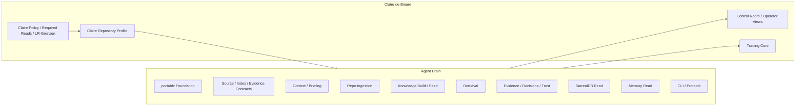
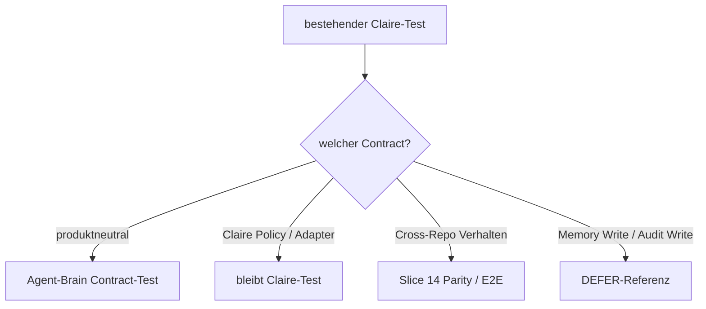

# Slice 0 — Extraction Canon Closeout

**Issue:** [#3](https://github.com/jannekbuengener/agent-brain/issues/3)  
**Claire Baseline:** `84b5e05765fcde402a2565aa37fd42081ee95355`  
**Ergebnis:** `READY_FOR_SLICE_1_WITH_STATE_MIGRATION_GATE`

## 1. Was Slice 0 festgestellt hat

Das bestehende Claire Context-/Agent-Brain ist **extrahierbar**, aber nicht als einfacher Ordner-Move.

Die saubere Grenze lautet:



Agent Brain besitzt die generische Kontext- und Evidence-Infrastruktur. Claire bleibt Consumer und besitzt weiterhin ihre Produkt-/Trading-Policy.

## 2. Inventar-Ergebnis

Auditiert wurden unter anderem:

- **78** Python-Dateien unter Claire `tools/surrealdb/` — vollständig einer primären Ownership-Gruppe zugeordnet.
- **19** Dateien unter `tools/mcp/` — vollständig `MOVE / ADAPTER / STAY / DEFER` zugeordnet.
- `infrastructure/config/surrealdb/` — Claire-Konfiguration von generischen Contracts getrennt.
- `infrastructure/surrealdb/` — Schema-/Fixture-/Permission-Flächen klassifiziert.
- aktive Context-/Tooling-Contracts unter `docs/surrealdb/` und `docs/contracts/context_tooling/`.
- **87** Tests unter `tests/unit/surrealdb/` — einem primären Slice-/DEFER-Gate zugeordnet.
- **31** Tests unter `tests/unit/tools/mcp/` — einem primären Slice-/DEFER-Gate zugeordnet.
- MCP Access Boundary, Agent-Brain-Adoption Contract und Tool Inventory als zusätzliche Cross-Slice-Gates.

Die vollständigen Listen stehen in:

- [COMPONENT_OWNERSHIP.md](COMPONENT_OWNERSHIP.md)
- [PARITY_GATES.md](PARITY_GATES.md)
- [`claire_extraction_inventory.v1.json`](../../contracts/extraction/claire_extraction_inventory.v1.json)

## 3. Wichtigste technische Entkopplungen

### Portable Foundation

46 `from core.*`-Treffer in `tools/surrealdb` zeigen die häufigste mechanische Kopplung. Wiederkehrend sind insbesondere:

- Claire Clock (`core.utils.clock`)
- Canonical JSON / Hashing (`core.replay.canonical_json`)

Diese gehören vor den eigentlichen Brain-Modulen in Slice #5 / Portable Foundation.

### Repository Profile statt Claire Canonical Root

Heute kennen Indexer, Required Reads, Cross-Repo Inventory und Context Bridge Claire direkt. Künftig gilt:

- Agent Brain kennt `RepositoryProfile` / `RepositorySource`.
- Claire liefert ein Claire-Profil.
- Sample Brain oder andere Repos können später eigene Profile liefern.
- kein Repository ist im generischen Core automatisch „canonical root“.

### Policy Overlay statt Trading-Begriffe im Core

LR, Echtgeld, Human-GO, Claire Required Reads und Trading-State-Verbote bleiben Claire-seitig bzw. werden als explizite Policy-Hooks eingespeist.

Der generische Core kennt weiterhin harte Sicherheitsprinzipien wie read-only/fail-closed, aber keine Claire-Fachautorität.

## 4. Persistierter State — WATCH F ist entschieden

Die Architekturfrage ist gelöst:

- Git-/GitHub-/Ledger-/Upstream-Mirrors → `REBUILD_FROM_SOURCE`
- SurrealDB-primary Evidence / Claim / Agent Memory → `MIGRATE`, falls Records vorhanden und valide
- verbotene/ungültige Daten → `DROP_WITH_REASON`
- produktive Agent-Memory-Write-Autorität → `DEFER`

Der aktuelle Record-Bestand wurde **nicht** als DB-backed verifiziert. Deshalb existiert jetzt der eigene Gate-Scope:

[#21 — STATE MIGRATION GATE](https://github.com/jannekbuengener/agent-brain/issues/21)

Damit wird Datenverlust nicht in Slice 13/Cutover „nebenbei“ behandelt.

## 5. Claire-Komponenten, die bewusst nicht in den Baseline-Core wandern

### STAY

- Claire Control Room / Operator View Builder und Signal Layer
- Claire-spezifische Required-Read-Kataloge
- Claire LR-/Echtgeld-/Control-Board-Policy
- Claire Governance / Constitution / Agent Policy
- lokale Claire Consumer Feature Flags
- historische Claire Proof-/Wave-Dokumentation

### DEFER

- produktive Agent-Memory Writes
- Memory Write Intent MCP
- T3/T4 Memory-/Audit-Write-Pfade
- Write-Gates / productive mock write proofs als allgemeine Agent-Brain-Funktion

Diese Flächen dürfen später separat bewertet werden, sind aber **keine Voraussetzung**, um das read-only-first Agent Brain sauber herauszulösen.

## 6. Test-/Parity-Strategie

Bestehende Claire-Tests werden dreigeteilt:



Die konkrete Zuordnung steht in [PARITY_GATES.md](PARITY_GATES.md).

## 7. Auswirkungen auf die Roadmap

### Slice 1 / #4

Kann beginnen. Scaffold darf aber noch keine konkrete Paket-API behaupten, die den hier definierten Ownership-Grenzen widerspricht.

### Slice 2 / #5

Muss mindestens Clock + Canonical JSON/Hashing als portable Foundation lösen, bevor die 46 Claire-Core-Importstellen schrittweise umgezogen werden.

### Slice 3 / #15

Muss `RepositorySource`, `RepositoryProfile`, Index-/Graph-Records, `EvidenceRef` und `ClaimRef` kanonisieren, bevor Ingestion/Retrieval auseinanderlaufen.

### Slice 4 / #6

Kann danach Context Package / Briefing übernehmen; Claire Guardrails kommen nur über Profile/Policy.

### State Gate / #21

Kann später parallel vorbereitet werden, sobald Shared Contracts und Build-/Seed-Semantik stabil sind. Er blockiert nicht das Scaffold, aber er **muss vor dem finalen Claire-Cutover** ein belastbares Handoff-Ergebnis liefern.

## 8. Acceptance von Issue #3

- [x] vollständiges Komponenten-Inventar liegt vor
- [x] relevante Brain-Flächen sind `MOVE / STAY / ADAPTER / DEFER`
- [x] jede relevante persistierte Datenklasse hat `REBUILD_FROM_SOURCE / MIGRATE / DROP_WITH_REASON / DEFER`
- [x] Claire-spezifische Policy ist vom generischen Brain-Kern getrennt
- [x] bestehende Tests sind späteren Slices als Parity-Gates zugeordnet
- [x] Abhängigkeitsrisiken und Reihenfolge sind dokumentiert
- [x] kein ungeklärter Ownership-Konflikt für Slice 1–4
- [x] echter Migrationsbedarf hat mit #21 einen eigenen Follow-up-Scope

## 9. Brain Evidence

```text
brain_source: repo-only
brain_status: not-used
tools_or_queries: GitHub Live, Repo Live, MCP repo reads, local read-only file search
records_or_results: no verified SurrealDB records used
repo_fallback_reason: Context briefing trust LOW / no usable enrichment records
```

Keine Aussage in diesem Canon setzt eine erreichbare oder befüllte SurrealDB voraus.

## 10. Exit

**Slice 0 Status:** `VALIDATED_PLANNING / READY_FOR_SLICE_1`

Nächster linearer Slice ist [#4 — Agent-Brain Scaffold und Repository-Baseline](https://github.com/jannekbuengener/agent-brain/issues/4).