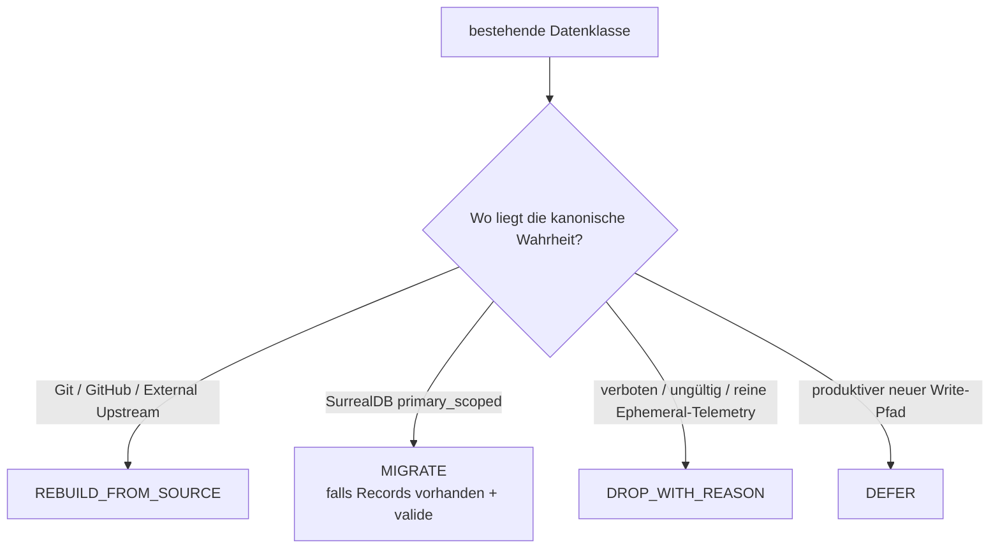
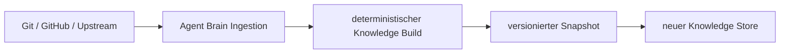

# State-Transition — was passiert mit bestehendem Claire-Brain-State?

**Slice:** #3 / Extraction Canon  
**Folge-Gate:** [#21 — SurrealDB-primary State Migration](https://github.com/jannekbuengener/agent-brain/issues/21)

## 1. Grundentscheidung

Nicht alles, was heute in SurrealDB stehen **kann**, ist dort die Wahrheit.

Claire besitzt bereits einen kanonischen Data-Ownership-Contract:

- Git-/Repo-Wissen ist überwiegend **Mirror**.
- GitHub-Zustand ist **Cache**.
- Decisions sind **Git-Ledger-Mirror**.
- `agent_memory`, Evidence und Claims sind **SurrealDB-primary/scoped**.
- Trading-State und Secrets sind **verboten**.

Daraus folgt:

## 2. Was wir aktuell **nicht** behaupten

Beim Slice-0-Audit lag **keine belastbare DB-Record-Evidence** vor. Das Context-Briefing war `repo-only` / `LOW` und enthielt keine DB-backed Records.

Deshalb sagt diese Matrix:

> **Welche Strategie gilt, falls Records existieren?**

Sie sagt **nicht**, wie viele Records aktuell tatsächlich in Claire-SurrealDB vorhanden sind. Diese Feststellung gehört in #21 und erfordert einen echten guarded read-only Adapter.

## 3. Kanonische Kategorien

| Datenklasse | Canon Claire | Transition | Begründung |
|---|---|---|---|
| Repo-/Datei-Wissen | Git | `REBUILD_FROM_SOURCE` | Hash-verifizierter Mirror |
| GitHub Issues / PRs | GitHub Live | `REBUILD_FROM_SOURCE` | TTL-Cache; Live-Quelle gewinnt |
| Context Tool / MCP Boundary | Repo-only | `REBUILD_FROM_SOURCE` | wird nicht als DB-Truth persistiert |
| Decisions / Decision Events | Git Ledger | `REBUILD_FROM_SOURCE` | Surreal ist append-only Mirror |
| External Docs | Upstream | `REBUILD_FROM_SOURCE` | TTL-Cache aus externer Quelle |
| Evidence | Git + SurrealDB / primary scoped | `MIGRATE` | nicht jeder gültige Evidence-Record muss aus Git rekonstruierbar sein |
| Claims | Git + SurrealDB / primary scoped | `MIGRATE` | append-only Primary-Anteil |
| Agent Memory | SurrealDB primary scoped | `MIGRATE` | primärer Store; TTL/Scope/Provenance erhalten |
| Shared Memory | SurrealDB primary scoped | `MIGRATE` | falls im tatsächlichen Store vorhanden |
| produktive neue Memory Writes | kein Baseline-Scope | `DEFER` | eigener Security-/Governance-Scope |
| Secrets / Broker Credentials | verboten | `DROP_WITH_REASON` | dürfen nicht ins Agent Brain |
| Live Positions / Orders / Fills / Risk State | Postgres/Runtime, im Brain verboten | `DROP_WITH_REASON` | keine Migration, kein Import |

## 4. Aktuelles SurrealDB-Schema — Tabelle für Tabelle

Der versionierte Claire-Schema-Snapshot listet 21 Tabellen. Für die Extraktion gilt:

| Tabelle | Transition | Begründung / Quelle |
|---|---|---|
| `agent_memory` | `MIGRATE` | SurrealDB-primary; nur valide, scoped, provenance-backed, TTL-konform |
| `artifact_cites_decision` | `REBUILD_FROM_SOURCE` | Relation aus Repo-Artefakt + Git-Ledger-Decision rekonstruierbar |
| `audit_observation` | `MIGRATE` | nur nicht rekonstruierbare, gültige append-only Audit/Evidence-Historie; #21 muss tatsächliche Ownership prüfen |
| `chunk_mentions_symbol` | `REBUILD_FROM_SOURCE` | aus Docs/Code deterministisch rekonstruierbar |
| `claim` | `MIGRATE` | Primary-scoped Claim-Anteil |
| `code_symbol` | `REBUILD_FROM_SOURCE` | Git/Code Mirror |
| `concept` | `REBUILD_FROM_SOURCE` | abgeleitetes Knowledge-Modell |
| `context_query` | `DROP_WITH_REASON` | Query-History ist keine deklarierte Source of Truth; keine stille Historienmigration |
| `contradiction` | `REBUILD_FROM_SOURCE` | aus aktuellem Claim/Evidence-Stand erneut berechnen |
| `decision_event` | `REBUILD_FROM_SOURCE` | Git-Ledger ist Canon |
| `dependency_edge` | `REBUILD_FROM_SOURCE` | aus Repo/Code/Config rekonstruierbar |
| `doc_chunk` | `REBUILD_FROM_SOURCE` | aus Git-Dokumenten rekonstruierbar |
| `doc_page` | `REBUILD_FROM_SOURCE` | aus Git-Dokumenten rekonstruierbar |
| `doc_section` | `REBUILD_FROM_SOURCE` | aus Git-Dokumenten rekonstruierbar |
| `evidence_ref` | `MIGRATE` | Primary-scoped Evidence-Anteil; Source Hash + Provenance verpflichtend |
| `knowledge_quality_score` | `REBUILD_FROM_SOURCE` | berechneter Qualitätszustand |
| `memory_supports_decision` | `REBUILD_FROM_SOURCE` | nach Memory-Handoff + Decision-Rebuild neu bilden |
| `repo_artifact` | `REBUILD_FROM_SOURCE` | Git Mirror |
| `scope_drift_event` | `REBUILD_FROM_SOURCE` | aus aktuellem Scope/Repo-State neu bewerten |
| `stale_context` | `REBUILD_FROM_SOURCE` | Staleness muss gegen neuen Live-State neu bestimmt werden |
| `visual_control_view` | `REBUILD_FROM_SOURCE` | generierte Claire-Operator-Ansicht, keine Primärwahrheit |

### Zusätzliche Canon-Domäne

`shared_memory` ist in Claire `ownership.yaml` als `surrealdb_primary_scoped` geführt, aber nicht Teil des aktuellen 21-Tabellen-v0-Snapshots. Daher:

- falls im realen Store/neueren Schema vorhanden → `MIGRATE` unter #21,
- falls nicht vorhanden → dokumentierter No-op,
- niemals aus fehlender Repo-Evidence eine Existenz behaupten.

## 5. Regeln für `MIGRATE`

Ein Record darf nur in den neuen Agent-Brain-State übernommen werden, wenn die jeweils erforderlichen Metadaten belegbar sind.

### Evidence / Claim

- Source Hash / Source Ref vorhanden und prüfbar
- Provenance vorhanden
- Scope nachvollziehbar
- keine verbotene Trading-/Secret-Nutzlast
- Append-only Identität erhalten
- Dubletten deterministisch erkennbar

### Agent / Shared Memory

- Scope und Namespace vorhanden
- Provenance (`source_refs` oder `evidence_refs`) vorhanden
- TTL / `expires_at` / Freshness auswertbar
- `superseded_by` erhalten
- Confidence erhalten
- abgelaufene oder strukturell ungültige Records werden nicht als aktuelle Wahrheit importiert

## 6. Regeln für `REBUILD_FROM_SOURCE`

Rebuild bedeutet **nicht**, alte DB-Zeilen in eine neue DB zu kopieren.

Die Build-/Seed-Mechanik gehört zu #16. Dadurch vermeiden wir das Mitschleppen veralteter Cache-, Stale- und Graph-Zustände.

## 7. Regeln für `DROP_WITH_REASON`

`DROP_WITH_REASON` bedeutet: bewusst nicht übernehmen und den Grund dokumentieren.

Zwingend:

- Secrets / Credentials
- Trading Runtime State
- Records ohne notwendige Provenance
- ungültige oder nicht interpretierbare Records
- reine Query-History ohne Canon-Status
- abgelaufene Caches, wenn die Live-Quelle erneut gelesen werden kann

Ein Drop darf nie verwendet werden, um einen gültigen SurrealDB-primary Record bequem zu umgehen.

## 8. State-Handoff-Gate #21

Issue #21 muss vor dem finalen Claire-Cutover `#13` ein Ergebnis liefern:

- `STATE_HANDOFF_GO` — actual primary state ist migriert oder nachweislich leer; kein stiller Verlust.
- `STATE_HANDOFF_BLOCKED` — echte Primary-Records können nicht sicher gelesen, validiert oder übertragen werden.

Die Implementierung von #10/#11 darf vorher gegen Fixtures erfolgen. **Der Consumer-Cutover darf aber keinen unaufgelösten Primary-State zurücklassen.**

## 9. Ergebnis für WATCH F

`WATCH F` ist als Architekturfrage **aufgelöst**:

- Rebuild-Klassen sind bestimmt.
- Migrationsklassen sind bestimmt.
- verbotene/drop-Klassen sind bestimmt.
- produktive Memory-Write-Autorität bleibt deferred.
- tatsächliche Record-Evidence und Durchführung besitzen mit #21 einen eigenen Gate-Scope.
