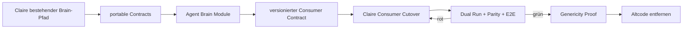

# Agent Brain — Extraction Design

**Stand:** 2026-10-20  
**Status:** Design bestätigt; Roadmap v2 gapsicher neu geschnitten; noch keine Produktimplementierung  
**Ziel:** Das heute in Claire de Binare eingebaute Context-/Agent-Brain kontrolliert in ein eigenständiges, generisches Repository extrahieren.  
**Operative Roadmap:** [Epic #2](https://github.com/jannekbuengener/agent-brain/issues/2)

## 1. Leitentscheidung

Agent Brain entsteht durch **Extraktion statt Rewrite**.

Wir übernehmen bewährte Contracts und Verhalten aus Claire, trennen dabei aber konsequent:

- generische Brain-Funktionen,
- Claire-spezifische Policy,
- persistierten Knowledge-/Index-State,
- Agent-Memory,
- Consumer-/Release-Verträge.

Kein Big-Bang-Cutover.

## 2. Zielbild

```text
agent-brain/
├─ apps/
│  ├─ brain-cli/
│  └─ brain-mcp/
├─ packages/
│  ├─ brain-core/
│  ├─ brain-retrieval/
│  ├─ brain-memory/
│  ├─ brain-surrealdb/
│  └─ brain-connectors/
├─ contracts/
├─ schemas/
├─ tests/
└─ docs/
```

Die konkrete Paketstruktur wird erst in den Implementierungs-Slices kanonisiert. Diese Darstellung beschreibt Verantwortungsbereiche, keine festgeschriebene Python-API.

## 3. Wahrheitshierarchie

Agent Brain ist **keine Source of Truth** für aktuellen Repository-Zustand.

1. GitHub Live
2. Repo Live
3. verifizierte Context-/DB-Evidence
4. kanonische Projektdateien
5. Ledger-/Statusdateien
6. Memory und frühere Agentenberichte

Niedrigere Ebenen dürfen höhere Ebenen nicht überschreiben.

## 4. Ownership-Matrix

| Fläche | Entscheidung | Begründung |
|---|---|---|
| Context Package / Briefing Envelope | MOVE | generisch und wiederverwendbar |
| Source Priority / Provenance / Trust | MOVE | Brain-Kernfunktion |
| Repo-/Code-/Documentation-Graph | MOVE | repoübergreifend nutzbar |
| Source-/Index-/EvidenceRef-Contracts | MOVE | gemeinsame Basis mehrerer Module |
| Hybrid Retrieval / Ranking | MOVE | produktneutral |
| Evidence-/Claim-Resolution | MOVE | produktneutral |
| Decision History / Decision Replay | MOVE | produktneutral, nicht autorisierend |
| Scope Drift / Stale / Contradiction / Quality | MOVE | generische Kontextqualität |
| Memory Contract / TTL / Freshness / Redaction | MOVE | generische Memory-Grundlage |
| Knowledge-/Index-Build + Seed/Import | MOVE NACH GENERALISIERUNG | reproduzierbare Build-Daten, nicht Agent-Memory |
| SurrealDB Query / Schema / Read Adapter | MOVE NACH GENERALISIERUNG | aktuell teilweise Claire-gekoppelt |
| Repo-/Workspace-Inventar | MOVE NACH GENERALISIERUNG | Prinzip generisch, aktuelle Implementierung Claire-zentriert |
| Distribution / Versionierung / Consumer Contract | MOVE | Voraussetzung für stabile Cross-Repo-Nutzung |
| Claire Live-Readiness / Echtgeld-Grenzen | STAY | Claire-spezifische Produktpolicy |
| Trading-State-Verbote | ADAPTER / CLAIRE POLICY | generischer Core kennt kein Trading |
| CONTROL_REGISTER / Claire Bootloader Reads | STAY | Claire-spezifisch |
| CDB-spezifische Env-Namen / Namespaces | ADAPTER | nicht generisch |
| produktive Agent-Memory-Writes | DEFER | eigener späterer Sicherheits-/Governance-Scope |
| Agent Workforce Rollen / Autorität | STAY IN AGENT-WORKFORCE | Workforce ist nicht Memory/Context |
| privater ChatGPT-MCP | OUT OF SCOPE | Operator-Fähigkeit, keine gemeinsame Agent-Infrastruktur |

## 5. Write-Klassen

### 5.1 Knowledge-/Index-Build-Writes

Erlaubter Scope innerhalb dieses Epics, aber nur explizit in Slice [#16](https://github.com/jannekbuengener/agent-brain/issues/16):

- deterministische Build-Artefakte,
- versionierte Knowledge-/Index-Snapshots,
- kontrollierter Seed/Import,
- Provenance und Source Hashes,
- reproduzierbare Fixtures.

### 5.2 Agent-Memory-Writes

Bleiben in diesem Epic `DEFER`.

Sie dürfen nicht stillschweigend über den Knowledge-Build-Pfad eingeführt werden.

## 6. Dokumentationsstandard

GitHub-facing Dokumentation ist **Human First**:

- Deutsch als Standardsprache.
- Zweck und Wirkung vor Implementierungsdetail.
- technische Begriffe beim ersten Auftreten erklären.
- Mermaid für Datenflüsse und Beziehungen.
- README und `docs/START_HIER.md` müssen ohne klassische Softwareausbildung verständlich sein.

Machine-facing Artefakte bleiben maximal präzise: APIs, Schemas, JSON/YAML, Contracts, Symbole und Tests.

## 7. Roadmap v2

Die Live-Issues sind die operative Arbeitsoberfläche.

### Slice 0 — Extraction Canon — [#3](https://github.com/jannekbuengener/agent-brain/issues/3)

Ownership, Abhängigkeiten, Parity-Gates und persistierte Datenklassen inventarisieren. Jede Datenklasse erhält `REBUILD_FROM_SOURCE / MIGRATE / DROP_WITH_REASON / DEFER`.

### Slice 1 — Scaffold — [#4](https://github.com/jannekbuengener/agent-brain/issues/4)

Repo-/Package-Baseline, CI, Tests, AGENTS und Doku-Surface.

### Slice 2 — Portable Foundation — [#5](https://github.com/jannekbuengener/agent-brain/issues/5)

Clock, Canonical JSON/Hashing, Identität, Provenance und Policy-Hooks ohne Claire-Abhängigkeit.

### Slice 3 — Shared Contracts — [#15](https://github.com/jannekbuengener/agent-brain/issues/15)

`RepositorySource`, `RepositoryProfile`, Index-/Graph-Record, `EvidenceRef`, `ClaimRef`, Schema-Versionierung und Producer-/Consumer-Grenzen.

### Slice 4 — Context Package / Briefing — [#6](https://github.com/jannekbuengener/agent-brain/issues/6)

Context Package, Briefing Envelope, Source Priority, Redaction und Nutzung der gemeinsamen Evidence-/Source-Refs.

### Slice 5 — Repository Ingestion / Connectors — [#9](https://github.com/jannekbuengener/agent-brain/issues/9)

Indexer, Repo Inventory, Include/Exclude-Regeln und standardisierte Ingestion-Outputs.

### Slice 6 — Knowledge Build / Seed / Import — [#16](https://github.com/jannekbuengener/agent-brain/issues/16)

Deterministischer Knowledge-/Index-Build, Snapshots, Schema-Versionierung und kontrollierter Befüllungspfad.

### Slice 7 — Retrieval / Knowledge Reasoning — [#7](https://github.com/jannekbuengener/agent-brain/issues/7)

Hybrid Retrieval, Ranking, Required Reads, Stop Resolver, Impact Radar und Explainability auf stabilen Contracts/Fixtures.

### Slice 8 — Evidence / Decisions / Trust — [#8](https://github.com/jannekbuengener/agent-brain/issues/8)

Evidence Resolver, Decision Replay, Contradictions, Stale, Scope Drift, Quality und Trust.

### Slice 9 — SurrealDB Read Runtime — [#10](https://github.com/jannekbuengener/agent-brain/issues/10)

Read Adapter, Query-Schutz, lokale Konfiguration, Noop/Fallback und Lesen der versionierten Knowledge-Stände.

### Slice 10 — Memory Read Side — [#11](https://github.com/jannekbuengener/agent-brain/issues/11)

TTL/Freshness, Provenance, Confidence, Rediscovery und Live-State-Revalidation. Keine produktiven Memory Writes.

### Slice 11 — Distribution / Versionierung / Consumer Contract — [#17](https://github.com/jannekbuengener/agent-brain/issues/17)

Package-/Dependency-Modell, Versionierung, Pinning, Cross-Repo Contract Tests, Upgrade und Rollback.

### Slice 12 — CLI / Protocol Surface — [#12](https://github.com/jannekbuengener/agent-brain/issues/12)

Standalone CLI und optionaler normaler Brain-MCP-Adapter. Core bleibt MCP-unabhängig.

### Slice 13 — Claire Adapter / Consumer Cutover — [#13](https://github.com/jannekbuengener/agent-brain/issues/13)

Claire konsumiert eine gepinnte Agent-Brain-Version über expliziten Adapter. Alter Pfad bleibt für Parity vergleichbar.

### Slice 14 — Parity / Dual Run / E2E — [#18](https://github.com/jannekbuengener/agent-brain/issues/18)

Alten und neuen Pfad vergleichen, Regressionen/E2E beweisen, Rollback testen und Cleanup-Go erzeugen.

### Slice 15 — Genericity Proof / Cleanup — [#19](https://github.com/jannekbuengener/agent-brain/issues/19)

Neutraler Consumer/Fixture-Proof und erst danach gezielter Altcode-Cleanup in Claire.

## 8. Gap Audit v2

Die ursprünglichen Gaps A–E sind **auf Planungsebene geschlossen**:

- **A:** Shared Source-/Index-Contracts stehen in #15 vor Ingestion/Build/Retrieval.
- **B:** #16 besitzt den reproduzierbaren Knowledge-Build-/Seed-Pfad; #10 bleibt read-only.
- **C:** #17 besitzt Distribution, Versionierung, Pinning, Cross-Repo Tests und Rollback.
- **D:** der ehemalige Monster-Cutover ist in #13, #18 und #19 geteilt.
- **E:** `EvidenceRef`/`ClaimRef` werden in #15 definiert; Resolution/Scoring kommt erst #8.

### WATCH F — persistierter Claire-State

Bleibt bewusst ein Slice-0-Gate. #3 entscheidet pro Datenklasse:

- `REBUILD_FROM_SOURCE`
- `MIGRATE`
- `DROP_WITH_REASON`
- `DEFER`

Nur bei echtem `MIGRATE` wird ein zusätzlicher Migrationsscope vor dem betroffenen Runtime-Slice angelegt.

## 9. Migrationsstrategie



## 10. Validation

Jeder Implementierungs-Slice muss mindestens beweisen:

1. bestehende Claire-Verträge wurden verstanden,
2. der portable Pfad funktioniert ohne Claire-Produktlogik,
3. Claire-spezifische Guardrails bleiben in Claire oder expliziten Adaptern,
4. niedrigere Evidence gewinnt nie gegen GitHub/Repo-Live-State,
5. relevante Regressionstests bleiben grün,
6. Consumer-Versionen sind reproduzierbar,
7. Altcode wird erst nach Parity- und Cleanup-Go entfernt.

## 11. Definition des ersten großen Meilensteins

Der Extraction-Meilenstein ist erreicht, wenn:

- Agent Brain eigenständig testbar läuft,
- gemeinsame Contracts produktneutral und versioniert sind,
- Knowledge-/Index-Build reproduzierbar ist,
- Claire eine konkrete Agent-Brain-Version konsumiert,
- Claire-spezifische Policy nicht in den generischen Kern geleakt ist,
- Parity und E2E grün sind,
- ein neutraler Genericity-Proof bestanden ist,
- alter doppelter Claire-Code sicher entfernt wurde.

Bis dahin ist `agent-brain` eine Extraktions- und Migrationsfläche, keine neue Autoritätsschicht.