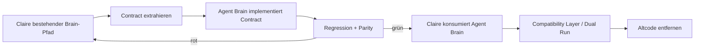

# Agent Brain — Extraction Design

**Stand:** 2026-10-20  
**Status:** Design bestätigt, noch keine Implementierung  
**Ziel:** Das heute in Claire de Binare eingebaute Context-/Agent-Brain kontrolliert in ein eigenständiges, generisches Repository extrahieren.  
**Operative Roadmap:** [Epic #2](https://github.com/jannekbuengener/agent-brain/issues/2)

## 1. Warum dieses Repository existiert

Claire de Binare besitzt bereits einen umfangreichen Context-, Evidence-, Decision-, Memory- und Retrieval-Layer. Viele dieser Funktionen sind nicht trading-spezifisch und sollen künftig von mehreren Projekten und Agenten genutzt werden können.

Das Ziel ist deshalb **Extraktion statt Rewrite**:

- bewährte Contracts und Tests wiederverwenden,
- generische Brain-Funktionen aus Claire herauslösen,
- Claire-spezifische Policy außerhalb des generischen Kerns halten,
- während der Migration keinen Big-Bang-Cutover durchführen.

## 2. Zielbild

Agent Brain wird ein eigenständiges Monorepo für wiederverwendbare Brain-Komponenten.

Vorgesehene Bereiche:

```text
agent-brain/
├─ apps/
│  ├─ brain-cli/
│  └─ brain-mcp/
├─ packages/
│  ├─ brain-core/
│  ├─ brain-retrieval/
│  ├─ brain-memory/
│  ├─ brain-surrealdb/
│  └─ brain-connectors/
├─ contracts/
├─ schemas/
├─ tests/
└─ docs/
```

Die konkrete Paketstruktur wird erst in den jeweiligen Implementierungs-Slices kanonisiert. Diese Liste beschreibt Verantwortungsbereiche, keine bereits freigegebene Python-Package-API.

## 3. Wahrheitshierarchie

Agent Brain ist **keine Source of Truth** für den aktuellen Repository-Zustand.

Priorität bei Widersprüchen:

1. GitHub Live
2. Repo Live
3. verifizierte Context-/DB-Evidence
4. kanonische Projektdateien
5. Ledger-/Statusdateien
6. Memory und frühere Agentenberichte

Niedrigere Ebenen dürfen höhere Ebenen nicht überschreiben.

## 4. Ownership-Matrix

| Fläche | Entscheidung | Begründung |
|---|---|---|
| Context Package / Briefing Envelope | MOVE | generisch und wiederverwendbar |
| Source Priority / Provenance / Trust | MOVE | Brain-Kernfunktion |
| Repo-/Code-/Documentation-Graph | MOVE | repoübergreifend nutzbar |
| Hybrid Retrieval / Ranking | MOVE | produktneutral |
| Evidence-/Claim-Resolution | MOVE | produktneutral |
| Decision History / Decision Replay | MOVE | produktneutral, solange keine Produktentscheidung autorisiert wird |
| Scope Drift / Stale / Contradiction / Quality | MOVE | generische Kontextqualität |
| Memory Contract / TTL / Freshness / Redaction | MOVE | generische Memory-Grundlage |
| SurrealDB Query / Schema / Index / Import | MOVE NACH GENERALISIERUNG | aktuell teilweise Claire-gekoppelt |
| Repo-/Workspace-Inventar | MOVE NACH GENERALISIERUNG | Prinzip generisch, aktuelle Implementierung Claire-zentriert |
| Claire Live-Readiness / Echtgeld-Grenzen | STAY | Claire-spezifische Produktpolicy |
| Trading-State-Verbote | ADAPTER / CLAIRE POLICY | allgemeiner Brain-Kern kennt kein Trading |
| CONTROL_REGISTER / Claire Bootloader Reads | STAY | Claire-spezifisch |
| CDB-spezifische Env-Namen / Namespaces | ADAPTER | dürfen nicht im generischen Kern bleiben |
| produktive Memory Writes | DEFER | eigener späterer Sicherheits-/Governance-Scope |
| Agent Workforce Rollen / Autorität | STAY IN AGENT-WORKFORCE | Workforce ist nicht Memory/Context |
| privater ChatGPT-MCP | OUT OF SCOPE | Operator-Fähigkeit, keine gemeinsame Agent-Infrastruktur |

## 5. Dokumentationsstandard

GitHub-facing Dokumentation ist **Human First**:

- Deutsch als Standardsprache.
- Zweck und Wirkung vor Implementierungsdetail.
- technische Begriffe beim ersten Auftreten erklären.
- Mermaid-Diagramme für Datenflüsse und Beziehungen.
- README und `docs/START_HIER.md` müssen ohne klassische Softwareausbildung verständlich sein.

Machine-facing Artefakte bleiben maximal präzise:

- APIs,
- Schemafelder,
- JSON/YAML,
- Contracts,
- Code-Symbole,
- Tests.

## 6. Migrationsstrategie

Kein Kopieren und anschließendes Hoffen.



## 7. Slice-Reihenfolge

Die Live-Issues sind die operative Arbeitsoberfläche; dieses Dokument beschreibt das Design dahinter.

### Slice 0 — Extraction Canon — [#3](https://github.com/jannekbuengener/agent-brain/issues/3)

Vollständige Inventarisierung und Klassifizierung `MOVE / STAY / ADAPTER / DEFER`. Keine Produktcodeänderung.

### Slice 1 — Agent-Brain Scaffold — [#4](https://github.com/jannekbuengener/agent-brain/issues/4)

Repo-Struktur, Python-/Workspace-Baseline, CI, Test-Baseline und Dokumentationssurface.

### Slice 2 — Portable Foundation — [#5](https://github.com/jannekbuengener/agent-brain/issues/5)

Claire-Abhängigkeiten für Clock, Canonical JSON/Hashing, Identität, Provenance und Policy-Hooks lösen.

### Slice 3 — Context Package & Briefing Core — [#6](https://github.com/jannekbuengener/agent-brain/issues/6)

Context Package, Source Priority, Redaction, Evidence Envelope und Briefing-Grundcontract extrahieren.

### Slice 4 — Retrieval & Knowledge Reasoning — [#7](https://github.com/jannekbuengener/agent-brain/issues/7)

Hybrid Retrieval, Ranking, Required Reads, Stop Resolver, Impact Radar und Graph-Grundverträge.

### Slice 5 — Evidence / Decisions / Trust — [#8](https://github.com/jannekbuengener/agent-brain/issues/8)

Evidence Resolver, Claims, Decision Replay, Contradictions, Stale Detection, Scope Drift, Quality und Trust.

### Slice 6 — Repository Ingestion & Connectors — [#9](https://github.com/jannekbuengener/agent-brain/issues/9)

Indexer, Repo Inventory und Importer generalisieren. Claire-spezifische Pfade werden Repo-Profile.

### Slice 7 — SurrealDB Read Runtime — [#10](https://github.com/jannekbuengener/agent-brain/issues/10)

Schema, Query Adapter, lokale DB-Konfiguration und read-only DB-Pfad.

### Slice 8 — Memory Read Side — [#11](https://github.com/jannekbuengener/agent-brain/issues/11)

Memory Contract, TTL/Freshness, Provenance, Read und Cross-Session Rediscovery.

### Slice 9 — CLI / Protocol Surface — [#12](https://github.com/jannekbuengener/agent-brain/issues/12)

Eigenständige CLI und optionaler normaler Brain-MCP-Adapter. MCP ist Interface, nicht Core-Abhängigkeit.

### Slice 10 — Claire Cutover + Genericity Proof — [#13](https://github.com/jannekbuengener/agent-brain/issues/13)

Claire konsumiert Agent Brain. Parity- und Dual-Run-Nachweis. Anschließend zweiter Consumer-/Fixture-Proof gegen versteckte Claire-/Trading-Kopplung.

### Offene Gap-Gates

Der lineare Slice-Plan ist noch **nicht vollständig implementierungsreif**. Der aktuelle Gap-Audit wird kanonisch in [Epic #2](https://github.com/jannekbuengener/agent-brain/issues/2) gepflegt.

Aktuell offen:

- **GAP A:** Retrieval benötigt einen Source-/Index-/Repo-Profile-Contract, bevor die konkrete Ingestion-Generalisation abgeschlossen ist.
- **GAP B:** SurrealDB Read benötigt einen reproduzierbaren Knowledge-/Index-Build-/Seed-/Import-Pfad; produktive Agent-Memory-Writes bleiben davon getrennt und `DEFER`.
- **GAP C:** Claire-Cutover benötigt Distribution, Versionierung, Pinning, Cross-Repo Contract Tests und Rollback-Regeln.
- **GAP D:** Slice #13 ist voraussichtlich zu breit und muss nach Auflösung des Consumer-Contracts neu geschnitten werden.
- **GAP E:** Context Package und Evidence Resolver benötigen einen früh kanonisierten minimalen `EvidenceRef`-/Claim-Referenzvertrag.

Die visuelle Gap-Ansicht steht in [DATENFLUESSE.md](../../DATENFLUESSE.md#7-offene-gaps-zwischen-den-slices).

## 8. Harte Non-Goals der ersten Extraktionsphase

- kein Big-Bang-Rewrite,
- keine Live-Trading-Autorität,
- keine Echtgeld-Autorität,
- keine Übernahme des Claire Trading-Cores,
- keine produktiven Agent-Memory-Writes,
- keine Abhängigkeit vom privaten ChatGPT-MCP,
- keine Agent-Workforce-Integration vor erfolgreichem eigenständigem Brain-Baseline-Proof.

## 9. Validation

Die Migration nutzt die vorhandenen Claire-Tests als Charakterisierungs- und Parity-Gates.

Jeder Implementierungs-Slice muss mindestens beweisen:

1. die betroffenen bestehenden Verträge sind verstanden,
2. der portable Pfad funktioniert ohne Claire-Produktlogik,
3. Claire-spezifische Guardrails bleiben in Claire oder einem expliziten Adapter erhalten,
4. keine niedrigere Evidence-Schicht gewinnt gegen GitHub/Repo-Live-State,
5. relevante Regressionstests bleiben grün,
6. Altcode wird erst entfernt, nachdem der neue Pfad Parity erreicht hat.

## 10. Definition des ersten großen Meilensteins

Der erste Extraction-Meilenstein ist erreicht, wenn:

- Agent Brain als eigenständiges Repo testbar läuft,
- Claire den generischen Brain-Kern über eine klar definierte Schnittstelle konsumiert,
- Claire-spezifische Policy nicht in den generischen Kern geleakt ist,
- die relevanten Claire-Regressionen und Parity-Gates grün sind,
- ein zweiter neutraler Consumer oder eine neutrale Fixture die Wiederverwendbarkeit beweist,
- die alte doppelte Implementierung sicher entfernt werden kann.

Bis dahin ist `agent-brain` eine Extraktions- und Migrationsfläche, keine neue Autoritätsschicht.
