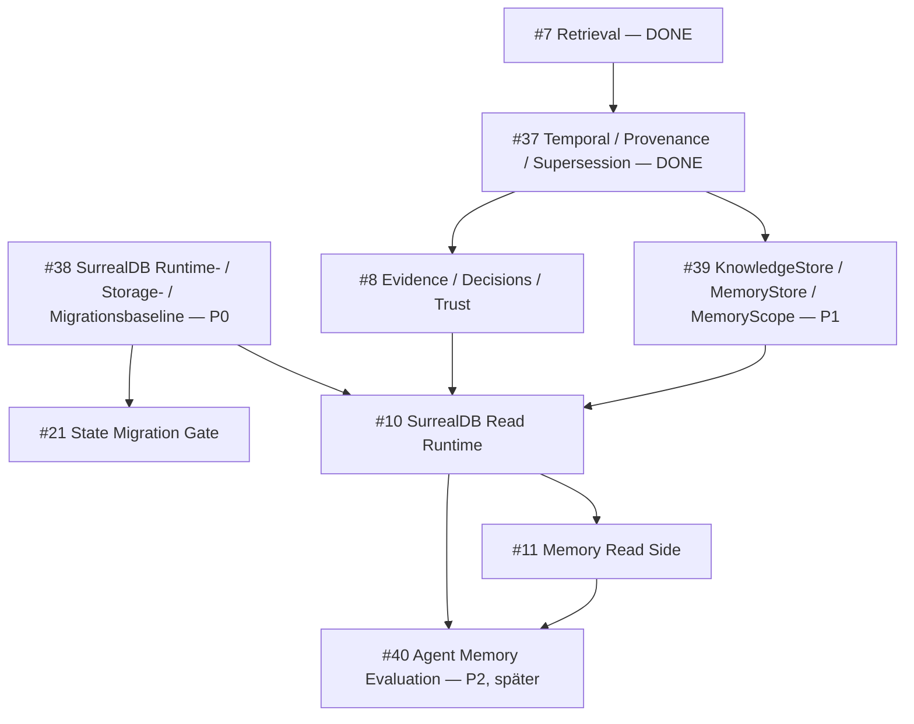

# Slice 8 — Evidence, Decisions und Trust Design

- **Issue:** #8 — Evidence, Decisions und Trust extrahieren
- **Status:** Design durch Jannek freigegeben; #37 Contract-GO erfüllt; noch keine Implementierung
- **Vorgänger:** #7 / Slice 7 — Hybrid Retrieval / Knowledge Reasoning
- **Harte Vorbedingung:** #37 — Temporal-/Provenance-/Supersession-Contracts (gemergt)
- **Nachfolger:** #10 / Slice 9 — SurrealDB Read Runtime
- **Claire-Extraction-Baseline:** `Claire_de_Binare@84b5e05765fcde402a2565aa37fd42081ee95355`
- **Stand:** 2026-10-21

## Context

Slice #7 liefert den produktneutralen Retrieval-Layer. Slice #8 beantwortet die nächste Frage: **Wie belastbar sind gefundene Claims, Evidence und Entscheidungen?** Der Slice-0-Canon weist Evidence Resolution, Decision Replay, Contradiction/Stale/Scope Drift, Quality und Trust explizit #8 zu.

Die kanonische Reihenfolge lautet:

```text
#15 Contracts → #7 Retrieval → #37 Temporal/Provenance/Supersession → #8 Evidence/Decisions/Trust → #10 DB-Read → #11 Memory
```

`EvidenceRef` und `ClaimRef` sind in #15 kanonisiert und bleiben reference-only. #37 hat die ergänzende Daten- und Contract-Semantik für Temporalität, Provenance und Supersession kanonisiert (`PR #42`, gemergt als `3b23f7542fe27a8efd1d62d9a20446e83dcf33de`, Issue #37 CLOSED/COMPLETED). **#8 besitzt Resolver- und Bewertungsverhalten, nicht Contract-Semantik.**

Die Claire-Baseline enthält die fachliche Referenzlogik, aber vermischt portable Mechanik mit Produktvokabular, Operator-Policy, lokalen Pfaden, nicht injizierter Zeit und späteren DB-/Memory-/Protocol-Flächen. Slice #8 extrahiert nur den generischen, deterministischen Core.

## Goal

Slice #8 liefert eine **produktneutrale, deterministische, side-effect-freie Signal-Pipeline**:

1. Claim↔Evidence Resolution auf `EvidenceRef`/`ClaimRef` plus den #37-Overlays.
2. Decision History + Decision Replay als Erklärung, nie Autorisierung.
3. Explizite Integrity-Findings für Contradiction, Freshness/Stale und Scope Drift.
4. Quality Assessment über sieben strukturierte Dimensionen.
5. Trust Summary mit `strong` / `partial` / `insufficient` und eigener Evidence-Sufficiency.

Alle Stufen laufen in-memory, ohne Netzwerk, DB oder versteckte Wall Clock.

## Non-Goals

Slice #8 enthält **nicht**:

- SurrealDB-Runtime, SurrealQL, DB-Client, DB-Auth oder produktive DB-Reads → #10.
- Jede Memory-Semantik einschließlich Read, Trust, TTL, Freshness und Writes → #11 bzw. späterer Write-Scope.
- Store-/Scope-Ports (`KnowledgeStore`, `MemoryStore`, `MemoryScope`) → #39.
- MCP-/Protocol-Server oder CLI als Core-Abhängigkeit → #12.
- Claire-Imports, `CDB_*`-Pflichtnamen, Produkt-/Markt-/Freigabesemantik oder Operator-Level.
- GitHub-Live-/Ledger-vs-Live-Policy.
- eine zweite Definition oder v2-Erweiterung von `EvidenceRef` / `ClaimRef`.
- eine zweite Temporal-, Provenance- oder Supersession-Contract-Schicht neben #37.
- einen monolithischen `TrustEngine` oder Service-Container.

## Existing Foundations

| Foundation | Verwendung in #8 |
| --- | --- |
| `EvidenceRef`, `ClaimRef` | Identität und Referenzbeziehungen; keine Trust-/Resolver-Autorität; in #37 unverändert bestätigt |
| `TemporalEnvelope` (`temporal-envelope/v1`) | Zeitliche Hülle der #8-Records: `known_at`, `valid_from`, `valid_until`, `system_as_of`; wird **konsumiert**, nicht neu definiert |
| `Provenance` (`provenance/v1`) | Herkunft und Lineage: `source_kind`, `source_ref`, `source_hash`, `source_span`, `source_session_id`, `source_turn_at`, `derived_from`; wird **konsumiert**, nicht neu definiert |
| `SourceSpan` | Eingebetteter Value Type aus #37 (0-based, end-exclusive, Unicode-Codepoints); keine eigene Schema-Familie, kein #8-Nachbau |
| `ResolutionMeta` (`resolution-meta/v1`) | Supersession-Links und getrennte `source_trust`/`confidence`; wird **konsumiert**, nicht neu definiert |
| `ResolutionState` | Read-side Enum aus #37 (`CURRENT`, `STALE`, `SUPERSEDED`, `UNKNOWN`); #8 **leitet** den Zustand ab und **speichert** ihn nie |
| `ArtifactRef`, `RepositorySource`, `RepositoryProfile` | Scope-/Provenienzbezug |
| `IndexRecord`, `GraphEdge` | Coverage / Dependency Confidence |
| `canonical_json_dumps`, `canonical_hash`, `sha256_hex` | stabile IDs, Hashes, Fixture-Vergleiche |
| `require_compatible_version` | Schema-Familienprüfung der neuen #8-Verträge; Slice-7-Präzedenz: slice-lokale Contract-Familien müssen nicht automatisch in `CONTRACT_SCHEMAS` aufgenommen werden |
| Contract Serialization | kanonische Result-Ausgabe |
| Slice-7 Contract-/Policy-Stil | immutable Contracts + injizierbare Policy + kleine Public Surface |

**Grundregel:** #15 bleibt Identität + Referenzen. #37 bleibt Zeit, Provenance und Supersession. #8 ergänzt **nur** Auflösung, Ableitung und Bewertung über additive Overlay-Contracts.

Vier Invarianten tragen den Slice:

1. **Status wird deklariert, nicht abgeleitet.** Der Producer erklärt `status`, `strength`, `requires_evidence`. Der Core leitet keinen Status aus anderen Daten ab. Fehlt ein `EvidenceState`, darf eine Policy nur einen konservativen Effective-Strength-Fallback liefern; dieser Fallback darf niemals `strong` erzeugen.
2. **Zeitabhängige Auswertung liegt ausschließlich in Stufe 3.** Nur `freshness.py` vergleicht Zeitstempel mit einem Referenzzeitpunkt. Der Resolver bewertet keine Freshness, keine Ablaufzeit, kein Alter.
3. **`ResolutionState` wird abgeleitet, nicht gespeichert.** #37 besitzt die Enum; #8 leitet den konkreten Zustand aus Temporalität, Supersession, Freshness und Konflikten ab.
4. **Quality und Trust aggregieren bereits berechnete Resultate;** sie rufen keine vorgelagerte Fachlogik erneut auf.

## Contract-Gate #37

#37 ist **erfüllt** und ist die harte Vorbedingung für #8.

| Nachweis | Wert |
| --- | --- |
| Issue #37 | CLOSED / COMPLETED (`2026-10-21T11:31:28Z`) |
| PR | #42 `feat: canonicalize temporal provenance contracts (#37)` — MERGED |
| Merge-SHA | `3b23f7542fe27a8efd1d62d9a20446e83dcf33de` |
| Merge in `main` | `3b23f75` |
| Registrierte Schema-Familien | `temporal-envelope`, `provenance`, `resolution-meta` in `CONTRACT_SCHEMAS` |
| `EvidenceRef` / `ClaimRef` | in #37 unverändert (reference-only bestätigt) |

### Was #8 von #37 konsumiert

| #37-Vertrag | #37-Semantik | Verwendung in #8 |
| --- | --- | --- |
| `TemporalEnvelope` | `known_at` Pflicht; `valid_from`/`valid_until` optional; `valid_until > valid_from`; `system_as_of` read-only Snapshot-Metadatum | Zeitliche Hülle aller #8-Records; `known_at` trägt die Sortierung, `valid_from`/`valid_until` die Gültigkeitsprüfung, `system_as_of` nur als Read-Metadatum |
| `Provenance` | `source_kind`, `source_ref`, optional `source_hash`/`source_span`/`source_session_id`/`source_turn_at`, `derived_from` | Herkunftsnachweis; `source_ref`/`source_hash` bilden die Provenance-Identität für die Konflikterkennung |
| `SourceSpan` | 0-based, end-exclusive, Unicode-Codepoints, `0 <= start < end` | Nur durchgereicht; #8 validiert oder interpretiert Span-Semantik nicht |
| `ResolutionMeta` | `supersedes_ref`, `superseded_by_ref`, `supersession_reason`, `source_trust` ∈ [0,1], `confidence` ∈ [0,1] | Supersession-Quelle, Grund der Ablösung, sowie die **getrennten** Trust-/Confidence-Werte |
| `ResolutionState` | `CURRENT`, `STALE`, `SUPERSEDED`, `UNKNOWN` | Zielzustand der #8-Ableitung; wird nie als gespeichertes Feld geführt |

### Was #8 nicht neu definieren darf

- Known-/Valid-/System-Time-Semantik, `TemporalEnvelope` und ihre UTC-/RFC3339-Regeln.
- Provenance-Grundstruktur, `SourceSpan` und dessen Offset-Semantik.
- Supersession-Grundsemantik und die Bedeutung von `supersedes_ref`/`superseded_by_ref`/`supersession_reason`.
- Die Bedeutung und Trennung von `source_trust` und `confidence`.
- `ResolutionState` und seine vier Werte.

### Was #8 liefert

Abgeleitete `ResolutionState`-Werte, Konfliktmaterialisierung, Resolver-/Assessment-Verhalten, Findings und Bewertungen. #8 ist ein **Konsument** von #37, kein zweiter Contract-Anbieter.

## Claire Source Characterization

Charakterisiert gegen die gepinnte Baseline `84b5e05765fcde402a2565aa37fd42081ee95355`.

| Claire-Fläche | Entscheidung | Portables Verhalten / Grenze |
| --- | --- | --- |
| `claim_resolver.py` | MOVE | Claim-Auswahl, Status-Buckets, Missing/Unresolved Evidence; Autoritätstexte entfernen |
| `evidence_lookup.py` | MOVE | Evidence-Auswahl/Stärke; Wall Clock entfernen; Freshness aus Resolver herauslösen |
| `claim_evidence_at_rest.py` Struktur-/Metadata-Gate | MOVE | Caller-Metadaten ersetzen keine Evidence |
| `claim_evidence_at_rest.py` DB-Pfad | DEFER #10 | SurrealQL/Adapter/DB |
| `claim_evidence_proof_runtime.py` | DEFER #10/#12 | DB/tmp/Env/Runtime-Proof |
| `claim_evidence_proof_cli.py` | DEFER #12 | CLI |
| `decision_history_query.py` | MOVE | Bucketing, Chain, Filter; Supersession **nur** aus `ResolutionMeta` |
| `decision_replay_builder.py` | MOVE | Replay, Ref-Status, Chain-Hash; Clock entkoppeln |
| `contradiction_scan.py` Finding-Modell | MOVE | explizite Findings |
| `contradiction_scan.py` generische Regeln | MOVE | 3 generische Regeltypen über RuleSet |
| übrige Contradiction-Regeln | DEFER #12/#13 | benötigen spätere Shapes, Memory oder Live-Surface |
| `contradiction_cli.py` | DEFER #12 | CLI |
| `stale_knowledge_scan.py` | MOVE reduziert | generische Stale-Typen; Memory-TTL nach #11 |
| `stale_refresh_plan.py` | MOVE reduziert | nur Empfehlungen; keine Workflow-/Write-Autorität |
| `stale_context_cli.py` | DEFER #12 | CLI |
| `scope_drift_firewall.py` Mechanik | MOVE | Scope-/Pfad-/Issue-/Surface-Vergleich |
| `scope_drift_firewall.py` Produktpolicy | ADAPTER | Pfade/geschützte Surfaces/Token beim Consumer |
| `scope_drift_blocking.py` | MOVE | generische Blocking-Ausgabe |
| `scope_drift_cli.py` | DEFER #12 | CLI |
| `quality_scoring.py` Mechanik | MOVE | 7 Dimensionen, Policy-isolierte Defaults |
| `quality_scoring.py` Memory-Dimension | DEFER #11 | vollständig aus #8 entfernen |
| `quality_scoring_cli.py` | DEFER #12 | CLI |
| `trust_summary.py` Mechanik | MOVE | Evidence/Claims/Decisions; keine Memory-Komponente |
| `trust_summary.py` Operator-/Live-Policy | DEFER #13 | Operator-Level, Repo-/Live-Heuristik |
| `negative_controls.py` | MOVE nur Invariante | keine Autorität/Secrets in Results; Write-Intent später |
| `negative_controls_matrix.py` | DEFER | Write-Scope |
| `architect_signals.py` | DEFER | Consumer/Readiness |
| `drift_report.py` | MOVE reduziert | Bericht über Findings |

### Erhaltenes Verhalten

- deterministische Claim↔Evidence-Verknüpfung;
- unresolved Evidence/Claim refs bleiben sichtbar;
- Claims ohne tragfähige Evidence werden nie als harte Wahrheit präsentiert;
- disputed / invalidated bleiben explizit; stale / superseded werden **abgeleitet** statt gespeichert;
- Decision Replay erklärt und autorisiert nie;
- Contradiction, Stale und Scope Drift werden als Findings materialisiert, nicht still gefiltert;
- Konflikte zwischen Provenance-Streams bleiben sichtbar; kein stilles Last-Write-Wins;
- gleiche logische Inputs ergeben gleiche Ordnung, IDs und Hashes.

### Bewusste Abweichungen

- Scope-Matching exakt statt Claire-Substring-Verhalten.
- einheitliches Trimmen von Query-Selektoren.
- Wall Clock → explizites `as_of`.
- `by_freshness` aus Evidence Resolution entfernen; Freshness ausschließlich in `freshness.py`.
- Supersession wird **nicht** aus einem Status-String abgeleitet, sondern ausschließlich aus `ResolutionMeta`.
- `stale`/`superseded` werden nicht gespeichert, sondern als `ResolutionState` abgeleitet.
- Cross-Provenance-Konflikte werden materialisiert statt still überschrieben.
- produktbezogene Freigabefelder → opake `authorization_refs`.
- Produkt-/Operator-Level nicht übernehmen.
- Memory vollständig #11.
- Workflow-Overrides wie `false_positive` / `accepted_risk` nach #12.

## Architecture

### Fünf Stufen

```text
#15 EvidenceRef / ClaimRef + #37 Temporal/Provenance/ResolutionMeta + #8 Overlays
        ↓
1. Resolution
   resolve_evidence / resolve_claims
        ↓
2. Decisions
   query_decision_history / build_decision_replay
        ↓
3. Integrity
   detect_contradictions | evaluate_freshness | detect_scope_drift
        ↓
4. Quality
   score_quality
        ↓
5. Trust
   build_trust_summary
        ↓
structured explanation + limitations
```

Stufe 3 besteht aus drei parallelen, unabhängigen Komponenten. Keine Stufe ruft eine spätere auf. Quality und Trust importieren Result-Typen, nicht die Fachlogik der Nachbarstufen.

Stufe 1 arbeitet **ohne** `as_of` (keine Zeitauswertung, keine Ablaufprüfung, keine Altersbewertung). Stufe 3 ist die einzige Stufe, die Zeitstempel gegen einen Referenzzeitpunkt auswertet; dort entsteht auch die abgeleitete `ResolutionState`.

## Package / Module Boundaries

```text
src/agent_brain/evidence/
    __init__.py
    contract.py
    resolver.py
    decisions.py
    contradiction.py
    freshness.py
    scope_drift.py
    quality.py
    trust.py
```

- `agent_brain.contracts.evidence` = Referenzverträge (`EvidenceRef`, `ClaimRef`).
- `agent_brain.contracts.temporal` / `.provenance` / `.resolution` = #37-Contract-Semantik.
- `agent_brain.evidence` = Resolution und Assessment.
- kein `cli.py`, `mcp.py`, `health.py`, Service-Container oder State Holder.

**Zusatzregel:** Kein Modul des Slice-8-Cores importiert `agent_brain.core.time` und ruft `utcnow()`, `SystemClock()`, `datetime.now()` oder `datetime.utcnow()` auf. Die Zeitpunkte kommen als `as_of` von außen.

## Contracts

### Typ A — Public Versioned Contracts

Serialisierbar und grenzüberschreitend: `schema_version`, `frozen=True`, `slots=True`, Validation, `to_dict`/`from_dict`, Compatibility Check.

**Overlays** — alle drei komponieren die #37-Contracts, statt eigene Zeit-, Provenienz- oder Supersession-Felder zu führen:

- `EvidenceState`: `evidence_id`, `temporal: TemporalEnvelope`, `provenance: Provenance`, `resolution_meta: ResolutionMeta`, `strength`, `status`.
- `ClaimState`: `claim_id`, `temporal: TemporalEnvelope`, `provenance: Provenance`, `resolution_meta: ResolutionMeta`, `status`, `scope`, `topics`, `uncertainty`.
- `DecisionRecord`: `decision_id`, `temporal: TemporalEnvelope`, `provenance: Provenance`, `resolution_meta: ResolutionMeta`, title/question/answer/decision_type/status/scope/topics, issue/evidence/claim/artifact refs, agent, `authorization_refs`, `requires_evidence: bool = False`.

`requires_evidence` wird vom Producer deklariert. Der Core entscheidet nicht selbst, ob Evidence erforderlich ist.

**Bewusst nicht mehr vorhandene #8-Felder:** `observed_at`, `updated_at`, `expires_at`, `created_at` (→ `temporal.known_at`), `superseded_by` (→ `resolution_meta.superseded_by_ref`), `confidence` (→ `resolution_meta.confidence`), `source_hashes` (→ `provenance.source_hash`), `invalidated_by` (→ deklarierter Status `invalidated`).

**Queries / Requests**

- `EvidenceQuery`
- `ClaimQuery`
- `DecisionQuery`
- `DecisionReplayQuery`
- `TrustRequest`

**Results**

- `EvidenceResolution`
- `ClaimResolution`
- `DecisionHistoryResult`
- `DecisionReplay`
- `ContradictionFinding` / `ContradictionScanResult`
- `StaleFinding` / `FreshnessReport` / `ResolutionStateEntry`
- `ScopeDriftFinding` / `ScopeDriftReport` / `ScopeDriftBlocking`
- `QualityDimensionScore` / `QualityAssessment`
- `TrustSummary`

**Policies**

- `QualityPolicy`
- `TrustPolicy`
- `FreshnessPolicy`
- `ScopeDriftPolicy`
- `EvidenceResolutionPolicy`
- `ClaimResolutionPolicy`

Policies sind immutable, deterministisch und frei von host-/repo-/produktspezifischen Defaults. Mapping-Felder werden readonly materialisiert.

### Typ B — Internal Immutable Input Types

Nicht als Prozess-/Dateivertrag serialisiert; immutable und validiert:

- `SourceState`
- `ArtifactState`
- `SurfaceState`
- `FreshnessBundle`
- `ContradictionBundle`
- `ScopeDriftBundle`
- `ContradictionRule`
- `ContradictionRuleSet`

Rule-/Bundle-Typen dürfen Funktionsreferenzen bzw. heterogene Domain-Records halten und sind deshalb bewusst keine Schema-Verträge.

Verbindliche Bundle-Semantik:

- `ContradictionBundle` enthält die benötigten `ClaimRef`/`ClaimState`, `EvidenceRef`/`EvidenceState` und `DecisionRecord`-Mengen **sowie** die Stage-1-Auflösungsergebnisse; Detektoren leiten Status, Strength oder Zeit nicht aus untypisierten Fremd-Dicts ab.
- `FreshnessBundle` trennt erwartete Dependency-Edges von aktuell beobachteten Edge-IDs. `dependency_edge_no_longer_observed` entsteht ausschließlich aus dieser expliziten Snapshot-Differenz; `GraphEdge.inferred` oder ein niedriger Confidence-Wert allein machen eine Edge nicht stale.
- `ScopeDriftBundle` enthält nur beobachtete/deklarierte Scope-Fakten und opake Autorisierungsreferenzen; es validiert keine Autorisierung.

### Generische Vokabulare

```text
EVIDENCE_STRENGTH_LEVELS = none, weak, moderate, strong, blocking_missing
EVIDENCE_STATUSES = active, revoked, unknown
CLAIM_STATUSES = unknown, proposed, supported, weakly_supported, disputed, invalidated
DECISION_STATUSES = unknown, proposed, accepted, parked, invalidated
SEVERITY_LEVELS = info, warning, blocking
FINDING_STATUSES = open, resolved, refreshed, replaced
QUALITY_GRADES = blocking, watch, weak, good
TRUST_LEVELS = strong, partial, insufficient
EVIDENCE_SUFFICIENCY_LEVELS = sufficient, partial, insufficient
```

**Konsumierter, nicht #8-definierter Zustand:** `RESOLUTION_STATES` stammt aus #37 (`ResolutionState`: `CURRENT`, `STALE`, `SUPERSEDED`, `UNKNOWN`).

`unknown` ist neutral und nie positiv. `stale` und `superseded` sind **keine gespeicherten Statuswerte**, sondern abgeleitete `ResolutionState`-Werte; deshalb stehen sie in keinem deklarierten Statusvokabular. `replaced` (statt `superseded`) bezeichnet einen abgelösten **Finding** und vermeidet die Wortgleichheit mit `ResolutionState.SUPERSEDED`. Consumer-Workflow-Zustände wie `false_positive`, `accepted_risk` oder `accepted_stale` sind nicht Teil der #8-Core-Semantik.

## Resolution State — Ableitung

`ResolutionState` ist ein **abgeleiteter Read-Zustand**. #8 speichert ihn nie und definiert keine konkurrierende State-Semantik. Die Ableitung ist Resolver-Verhalten auf Basis von #37-Inputs und #8-Signalen.

Da nur Stufe 3 Zeitstempel gegen einen Referenzzeitpunkt auswerten darf, entsteht die Ableitung in `freshness.py` und wird im `FreshnessReport` als `resolution_states: tuple[ResolutionStateEntry, ...]` ausgeliefert. Jeder Eintrag trägt `ref`, `entity_kind`, `resolution_state: ResolutionState` (Wert aus #37), `reason_code` und `explanation`.

**Präzedenz:** `UNKNOWN` > `SUPERSEDED` > `STALE` > `CURRENT`.

| Bedingung | Zustand | `reason_code` |
| --- | --- | --- |
| `temporal.known_at > as_of` | `UNKNOWN` | `not_yet_known` |
| `temporal.valid_from > as_of` | `UNKNOWN` | `not_yet_valid` |
| `temporal.valid_until <= as_of` | `STALE` | `validity_window_closed` |
| `resolution_meta.superseded_by_ref` gesetzt, Ziel bekannt | `SUPERSEDED` | `superseded_by_ref` |
| `resolution_meta.superseded_by_ref` gesetzt, Ziel unbekannt | `UNKNOWN` | `broken_supersession_chain` |
| Cross-Provenance-Konflikt | `UNKNOWN` | `cross_provenance_conflict` |
| sonst | `CURRENT` | `current` |

Weitere Regeln:

- `system_as_of` wird **nie** gegen Fakt-Zeiten verglichen. Es ist Read-/Snapshot-Metadatum und wird ausschließlich als solches durchgereicht.
- Fehlende Gültigkeitsangaben (`valid_from`/`valid_until` = `None`) erzeugen **keine** Stale-Behauptung; die Zeitlage gilt dann als unbestimmt und wird als Limitation sichtbar.
- Die Ableitung erzeugt keine Autorität. Ein `CURRENT` bedeutet „kein bekannter Störfaktor zum Auswertungszeitpunkt", nicht „wahr".

## Data Flow

| Stufe | Eingang | Ausgang | `as_of` |
| --- | --- | --- | --- |
| Resolution | #15 Refs + #37 Overlays + Query/Policy | `EvidenceResolution`, `ClaimResolution` | nein |
| Decisions | `DecisionRecord[]` + Query | `DecisionHistoryResult`, `DecisionReplay` | History nein, Replay ja |
| Integrity | Bundles + Policies | Contradiction/Freshness/Scope Results inkl. abgeleiteter `ResolutionState` | ja |
| Quality | Resultate 1–3 + `SurfaceState[]` + Policy | `QualityAssessment` | ja |
| Trust | `TrustRequest` + Resultate 1/2/3/4 + Policy | `TrustSummary` | übernimmt Assessment-Zeit |

Trust darf Stage-3-Reports direkt **nur** lesen, um blockierende Findings transparent in `TrustSummary.blocking_findings` zu referenzieren; es berechnet keine Integrity-Signale neu. Quality bleibt die einzige Score-Aggregation über Stage 1–3.

Datenqualitätsprobleme werden als Warnungen/Limitations/Findings sichtbar. Strukturell ungültige Requests oder Contracts schlagen fail-closed fehl. `limitations` ist für die top-level Aufrufergebnisse (`EvidenceResolution`, `ClaimResolution`, `DecisionHistoryResult`, `DecisionReplay`, `ContradictionScanResult`, `FreshnessReport`, `ScopeDriftReport`, `QualityAssessment`, `TrustSummary`) Pflicht; verschachtelte Finding-/Dimension-Contracts müssen kein eigenes `limitations`-Feld tragen.

## Evidence / Claim Resolution

Resolution löst **Identität, Beziehungen, deklarierten Zustand und Provenance-Konflikte**, aber keine Zeit.

### `resolve_evidence`

```python
def resolve_evidence(*, evidence, states=(), query=None, policy=None) -> EvidenceResolution
```

- Overlay per `evidence_id`; orphan States erzeugen Warnung.
- Stärke aus `EvidenceState.strength`; fehlt der State, gilt ausschließlich `EvidenceResolutionPolicy.default_strength` als konservativer Effective-Strength-Fallback (Core-Default `weak`). `content_hash`/`source_refs` dürfen Provenienz erklären, aber den fehlenden State **nicht** automatisch auf `strong` hochstufen.
- Producer-Status wird nur durchgereicht und gezählt.
- Query-Modi: Artifact, Claim, Decision, Source, Evidence Type, Strength, Status.
- **kein** `by_freshness`, **kein** `as_of`, **keine** Expiry-/Age-Auswertung, **keine** `ResolutionState`-Vergabe.
- `resolve_evidence` erfindet keine `unresolved_evidence_refs`, weil ihm keine fremden Claim-/Decision-Referenzmengen vorliegen. Orphan States werden hier gemeldet; unresolved Evidence-Refs aus Claims/Decisions gehören in `ClaimResolution` bzw. `DecisionHistoryResult`/`DecisionReplay`.

### `resolve_claims`

```python
def resolve_claims(*, claims, states=(), evidence=(), query=None, policy=None) -> ClaimResolution
```

- fehlt `ClaimState`, Status `unknown` + sichtbare Warnung;
- `ClaimRef.evidence_refs` wird gegen bekannte `EvidenceRef.evidence_id` aufgelöst;
- unresolved refs und missing-evidence Claims bleiben explizit;
- Buckets aus deklarierten Statuswerten: disputed / invalidated / missing-evidence;
- **keine** Buckets für `stale` oder `superseded` — das sind abgeleitete `ResolutionState`-Werte und entstehen in Stufe 3;
- keine Resolution erzeugt Autorität.

Sortierung erfolgt stabil über `temporal.known_at` + ID; undatierte Records stehen hinten. Input-Reihenfolge ändert das Ergebnis nicht.

### Cross-Provenance-Konflikt

Kandidaten mit derselben logischen ID (`evidence_id` bzw. `claim_id`), aber unterschiedlicher `provenance.source_ref` oder `provenance.source_hash` und **ohne** explizite Supersession-Beziehung sind ein Konflikt.

Verhalten:

- alle beteiligten Kandidaten bleiben sichtbar;
- es wird **kein** Gewinner gewählt — kein stilles Last-Write-Wins;
- die Konfliktgruppe wird in `conflicting_evidence_ids` bzw. `conflicting_claim_ids` ausgewiesen;
- die betroffenen Records erhalten in Stufe 3 den abgeleiteten Zustand `UNKNOWN` mit `reason_code = cross_provenance_conflict`;
- der Konflikt wird in Stufe 3 zusätzlich als Finding `cross_provenance_conflict` materialisiert.

Besteht zwischen den Kandidaten eine Supersession-Beziehung, ist es **kein** Konflikt: die Kette wird verwendet, der Vorgänger wird `SUPERSEDED`.

## Decision History / Replay

### `query_decision_history`

- Bucketing aus #37-Supersession: `superseded_by_ref` gesetzt und Ziel bekannt → superseded; deklarierter Status `invalidated` → invalidated; `superseded_by_ref` gesetzt, Ziel unbekannt → unresolved (wird in Stufe 3 `UNKNOWN`); sonst current.
- Supersession Chains zyklussicher über `visited`; `supersession_reason` wird im Chain-Eintrag mitgeführt.
- dangling links bleiben sichtbar (`broken_supersession_chain`) und werden **nicht** still auf current zurückgestuft.
- fehlen bekannte Evidence-/Claim-ID-Mengen, gilt Resolution als **nicht durchgeführt**, nicht als erfolgreich.

### `build_decision_replay`

```python
def build_decision_replay(*, decisions, query, as_of, known_evidence_ids=None,
                          known_claim_ids=None, evidence_summaries=None,
                          claim_summaries=None) -> DecisionReplay
```

- Replay erklärt nur.
- historische Buckets bleiben vom Sichtbarkeitsfilter getrennt; ein nicht sichtbarer Nachfolger ändert den Bucket nicht, er erzeugt die Sichtbarkeitswarnung.
- `decision_chain_hash` schließt `as_of` aus.
- unresolved refs bleiben sichtbar.
- `authorization_refs` werden durchgereicht, nie ausgewertet.
- `authorization_implied` ist immer `False`.

## Contradiction

Contradiction trennt portable Findings von einer injizierbaren RuleSet-Policy.

`ContradictionRule` trägt `rule_id`, `rule_type`, `severity`, `confidence`, Beschreibung, Empfehlung und pure Detector-Referenz. Severity/Confidence sind **Daten der Regel**, keine im Algorithmus verteilten Literale.

Default-Scope: drei generische Claire-basierte Regeltypen:

- `claim_vs_evidence`
- `decision_vs_evidence`
- `stale_decision_vs_new_evidence`

Dazu kommt **ein aus #37 mandatiertes** Regeltyp, nicht aus Claire abgeleitet:

- `cross_provenance_conflict` — materialisiert die in Stufe 1 erkannten Konfliktgruppen als sichtbares Finding mit Severity `blocking`, damit der Konflikt nicht nur als Datenmerkmal, sondern als explizites Integritätssignal erscheint.

Weitere Claire-Regeln, die spätere Shapes, Memory oder Live-Surface brauchen, bleiben deferred. Findings sind deterministisch sortiert und erhalten stabile IDs aus canonical hash. Workflow-Overrides sind nicht Teil des Core.

## Freshness / Stale

Freshness ist die **einzige** #8-Komponente, die Zeitstempel gegen einen Referenzzeitpunkt auswertet. Sie erzeugt zugleich die abgeleitete `ResolutionState`.

```python
def evaluate_freshness(*, bundle: FreshnessBundle, policy=None, as_of) -> FreshnessReport
```

Generische Stale-Typen:

- `source_hash_changed`
- `source_deleted`
- `validity_window_closed` — `temporal.valid_until <= as_of`
- `dependency_edge_no_longer_observed`
- `stale_context_package`
- `stale_briefing`

`memory_ttl_expired` gehört #11. `decision_superseded` entfällt als Stale-Typ: Ablösung ist Supersession-Semantik aus #37 und damit `ResolutionState.SUPERSEDED`, keine Zeitfrage.

Für `dependency_edge_no_longer_observed` gilt eine harte Trennung von Freshness und Quality: `FreshnessBundle` liefert erwartete Edges plus explizite aktuell beobachtete Edge-IDs. Nur eine erwartete, aktuell nicht beobachtete Edge erzeugt dieses Stale-Finding. `GraphEdge.confidence` und `GraphEdge.inferred` werden hier **nicht** als Staleness-Proxies verwendet; die Confidence-Schwelle gehört ausschließlich in `QualityPolicy.dependency_confidence_threshold`.

Mechanismen: Gültigkeitsfenster vs. `as_of`, Freshness Window, Snapshot Identity, Provenance-Hash-Drift. Fehlende/unparsbare Zeitinformation erzeugt keine künstliche Freshness und keine unbelegte Stale-Behauptung; sie erzeugt Warnung/Limitation. `system_as_of` wird nicht als Fakt-Zeit verwendet.

Refresh-Ausgabe bleibt Empfehlung (`reverify_source`, `refresh_evidence`, `recheck_decision`, `rebuild_context_package`, `regenerate_briefing`, `reobserve_dependency_edge`, `manual_review`) und trägt keine Write-Autorität.

## Scope Drift

Scope Drift trennt Mechanik von Consumer-Policy.

```python
def detect_scope_drift(*, bundle: ScopeDriftBundle,
                       policy: ScopeDriftPolicy,
                       as_of) -> ScopeDriftReport
```

`ScopeDriftPolicy` ist Pflichtparameter. Der Core kennt keine produktspezifischen Pfade oder Surface-Kataloge.

Generische Drift-Typen:

- `path_out_of_scope`
- `forbidden_surface_touched`
- `runtime_surface_touched`
- `write_intent_without_authorization_ref`
- `write_mode_without_authorization_ref`
- `domain_out_of_scope`
- `issue_out_of_scope`
- `unexpected_dependency_expansion`

Pfadvergleich respektiert Verzeichnisgrenzen; Globs sind explizit. Leere `target_paths` deaktivieren nur die Pfadregel.

### Authorization references

`authorization_refs` sind opake Referenzen. Der Core darf Presence prüfen, wenn eine generische Policy das verlangt. Fehlt die Referenz bei einem schreibähnlichen Intent/Mode, darf er ausschließlich den fehlenden Referenznachweis melden (`write_*_without_authorization_ref`). Ist eine Referenz vorhanden, entfällt nur dieses Missing-Reference-Finding; daraus entsteht **keine** positive Autorisierungsaussage. Der Core darf **nicht** Gültigkeit prüfen, eine Freigabe ableiten oder Referenzinhalte interpretieren.

**Presence ≠ Authorization.** `ScopeDriftBlocking` materialisiert deshalb nur `blocking`, `blocking_count`, `summary`, betroffene Artefakte, Findings und generische `recommended_actions`/`recommended_next_reads`. Es enthält weder `operator_action` noch `anti_actions` oder ein autoritätsbehauptendes Feld.

## Quality Scoring

Slice #8 bewertet **genau sieben** Dimensionen:

1. coverage
2. freshness
3. evidence
4. contradiction
5. dependency_confidence
6. decision_validity
7. scope_risk

Memory existiert weder als aktive noch als optionale Dimension.

```python
def score_quality(*, scope_id, as_of, level="system", surfaces=(),
                  dependency_edges=(), evidence_resolution=None,
                  claim_resolution=None, decision_history=None,
                  contradictions=None, freshness=None, scope_drift=None,
                  policy=None) -> QualityAssessment
```

Mechanik:

- `coverage`, `evidence`, `decision_validity` und `dependency_confidence` sind Zähldimensionen: erfüllte Kriterien / verfügbare Kriterien. `dependency_confidence` zählt ausschließlich `GraphEdge.confidence >= QualityPolicy.dependency_confidence_threshold`; deshalb sind `dependency_edges` expliziter Input.
- `contradiction`, `freshness` und `scope_risk` verwenden dieselbe deterministische Penalty-Mechanik über aktive Findings: `max(0, 1 - Σ policy.severity_penalties[finding.severity])`. Ein vorhandener Report ohne aktive Findings ergibt `1.0`; ein fehlender Report macht die Dimension unverfügbar.
- Freshness wird aus `FreshnessReport` abgeleitet, nicht neu berechnet.
- fehlende Dimensionen werden nicht mit neutralem `0.5` erfunden; sie werden ausgelassen und als Limitation sichtbar.
- alle Gewichte, Grade-Bänder, Penalties und Thresholds liegen in `QualityPolicy`, nicht versteckt im Algorithmus.

Quality erfindet **keine** Temporal-, Provenienz- oder Supersession-Semantik. Sie konsumiert die abgeleitete `ResolutionState` und die Findings der Stufen 1–3, wie sie dort materialisiert wurden.

## Trust Summary

`TrustSummary` ist Assessment, nicht Autorität.

```text
TRUST_LEVELS = strong, partial, insufficient
EVIDENCE_SUFFICIENCY_LEVELS = sufficient, partial, insufficient
```

Genau drei Trust-Komponenten:

- evidence → `EvidenceResolution`
- claims → `ClaimResolution`
- decisions → `DecisionHistoryResult`

Keine Memory-Komponente.

```python
def build_trust_summary(*, request, evidence_resolution=None,
                        claim_resolution=None, decision_history=None,
                        contradictions=None, freshness=None,
                        scope_drift=None, quality=None,
                        policy=None) -> TrustSummary
```

Die Stage-3-Reports dienen hier ausschließlich dazu, konkrete blockierende Findings und Evidence-Sufficiency-Limitations sichtbar zu referenzieren. Sie werden nicht erneut gescored; der Composite-Score besteht weiterhin nur aus den drei Komponenten Evidence/Claims/Decisions. `assessed_at` wird aus `QualityAssessment.scored_at` übernommen und ist ohne Quality-Assessment `None`.

`TrustPolicy.required_components` ist standardmäßig Evidence + Claims + Decisions. Fehlt eine Pflichtkomponente, darf das Ergebnis nie `strong` werden; fehlen alle Komponenten, ist es `insufficient`. Blocking Findings erzwingen `insufficient` und bleiben sichtbar.

`evidence_sufficiency` trägt AC5 unabhängig vom Gesamtscore direkt maschinenlesbar.

### Source trust vs. confidence

`source_trust` und `confidence` werden **getrennt** konsumiert und **getrennt** erklärt. Sie werden nie voneinander abgeleitet, nie gegenseitig überschrieben und nie zu einem gemeinsamen Wert kollabiert.

| Wert | Bedeutung | Quelle |
| --- | --- | --- |
| `source_trust` | Vertrauen/Prior der Quelle | `ResolutionMeta.source_trust` |
| `confidence` | Sicherheit der Extraktion bzw. der Aussage | `ResolutionMeta.confidence` |

`TrustSummary` führt dafür zwei **unabhängige** Auswertungen:

- `source_trust_assessment` — erfasst `source_trust` über die einbezogenen Records, inklusive Zahl nicht bewerteter Records;
- `confidence_assessment` — erfasst `confidence` über dieselben Records, unabhängig davon.

Beide Auswertungen sind **keine** Trust-Komponenten und fließen **nicht** in `composite_score` ein. Wer beide zu einem Wert zusammenführen will, tut das in einer eigenen Policy eines Consumers — der Core tut es nicht. Fehlt einer der Werte, gilt das als *nicht bewertet*, nicht als niedriger Wert.

## Policy Boundaries

**Regel:** Der Core enthält keine **produktspezifischen** Zahlen. Alle Score-, Threshold-, Penalty- und Gewichtungswerte liegen in expliziten Policy- oder RuleSet-Objekten. Neutrale Default-Policies sind erlaubt; versteckte score-relevante Zahlen im Algorithmus-Code sind verboten.

| Wert | Entscheidung | Begründung |
| --- | --- | --- |
| Qualitäts-Gewichte | Core-Default: **gleich gewichtet** über alle verfügbaren Dimensionen | Claire-Gewichte sind eine Produktmeinung und gehören ausschließlich in die Parity-/Adapter-Policy |
| Grade-Bänder | Core-Default **ausschließlich** in `QualityPolicy.default()`: `blocking < 0.30`, `watch < 0.50`, `weak < 0.70`, `good >= 0.70` | etabliertes generisches Grade-Vokabular; keine verstreuten Magic Numbers im Algorithmus |
| Severity-Penalties | Core-Default **ausschließlich** in `QualityPolicy.default()`: `blocking = 0.50`, `warning = 0.25`, `info = 0.0` | konservativer generischer Default; Claire-Werte bleiben Parity-/Adapter-Policy |
| Trust-Komponenten-Gewichte | Core-Default: **gleich gewichtet** über Evidence/Claims/Decisions | der Core trifft keine Produktmeinung |
| Trust-Schwellen | Core-Default: `strong >= 0.80`, `partial >= 0.50` | generische Default-Bänder |
| `TrustPolicy.required_components` | Core-Default: Evidence + Claims + Decisions, alle drei required | fehlende Pflichtkomponente deckelt auf `partial` |
| Finding-Exemptions | **Policy-gesteuert**: welche Statuswerte von Penalties ausgenommen sind, entscheidet die jeweilige Policy | keine produkt- oder workflow-spezifischen Core-Exemptions |
| Freshness-Window | Core-Default: `86_400` s (Dauer, nie Zeitpunkt) | generischer Wert; Policy-Zeitwerte sind ausschließlich Dauern |
| Scope-Drift `max_artifact_count` | Core-Default: `20`, wirkt nur bei deklarierten `target_paths` | generischer Konservativwert |
| Produktpfade, geschützte Surface-Typen, Default-Reads | Policy-Felder, kein Core-Default | reine Produkt-/Repo-Policy |
| Contradiction Severity/Confidence | Daten des injizierten `ContradictionRuleSet` | keine Literale im Algorithmus |
| `requires_evidence` | Producer-Feld am `DecisionRecord` | der Producer erklärt den Bedarf |

Policies sind immutable, deterministisch, enthalten keine versteckte Wall Clock, keine host-/repo-spezifischen Pfade im Core-Default und keine Produktvokabulare. Claire-spezifische Zahlen erscheinen ausschließlich in `tests/fixtures/evidence/claire_parity_policy.v1.json`.

## Determinism

- **Stabile Sortierung** über kanonische Schlüssel, nie über Eingabe- oder Dict-Reihenfolge:
  - Claims/Evidence/Decisions: `(0, temporal.known_at_iso, id)` / `(1, "", id)`; undatierte Elemente stehen hinten.
  - Findings: `(severity_order, rule_type, finding_id)`.
  - Buckets: Reihenfolge der Gesamtliste, nicht alphabetisch.
- **Keine Dict-/Set-Reihenfolge** im Ergebnis. Sets dienen nur der Membership; Ergebnisse entstehen über sortierte Tupel.
- **Keine Randomness.** Kein `uuid`, kein `random`.
- **Keine implizite Wall Clock.** Kein Modul des Slice-8-Cores ruft `utcnow()`, `SystemClock()`, `datetime.now()` oder `datetime.utcnow()` auf; `agent_brain.core.time` wird nicht importiert.
- **Explizites `as_of` nur dort, wo Zeit ausgewertet wird oder ein Auswertungszeitpunkt im Result steht:**

| Funktion | `as_of` | Grund |
| --- | --- | --- |
| `resolve_evidence` | nein | keine Zeitauswertung, kein Zeitstempel im Result |
| `resolve_claims` | nein | dito |
| `query_decision_history` | nein | Sortierung nach `temporal.known_at` ist keine Zeitauswertung |
| `build_decision_replay` | ja | `current_status.as_of` |
| `detect_contradictions` | ja | jedes Finding trägt `detected_at` |
| `evaluate_freshness` | ja | wertet Gültigkeitsfenster und Alter gegen `as_of` aus |
| `detect_scope_drift` | ja | jedes Finding trägt `detected_at` |
| `score_quality` | ja | `QualityAssessment.scored_at` |
| `build_trust_summary` | nein | erbt den Zeitpunkt aus `QualityAssessment.scored_at` |

- **Clock-Erzeugung liegt beim Consumer.** `agent_brain.core.time.utcnow()` bzw. `FixedClock` in Tests liefert den Wert, der als `as_of` übergeben wird.
- **Kanonische Serialisierung** nur über `agent_brain.core.canonical` und `agent_brain.contracts.serialization`.
- **Gleiche logische Inputs → identisches Ergebnis**, inklusive identischer IDs und Hashes — auch bei umgekehrter Eingabereihenfolge.
- **Finding-/Decision-/Resolution-IDs** werden als `canonical_hash(payload)[:16]` gebildet; kein Zeitstempel und keine Eingabereihenfolge fließen in den ID-Payload ein.
- **`decision_chain_hash`** schließt `as_of` bewusst aus; zwei Replays mit unterschiedlichem `as_of` bei gleicher Datenlage sind hashgleich.

## Conservative Defaults

| Situation | Verhalten |
| --- | --- |
| Evidence fehlt | keine starke Trust-Aussage; `evidence_sufficiency` ≤ `partial` |
| Unbekannter Evidence-Ref | `unresolved`; Claim/Decision landet in `missing_evidence_claim_ids` |
| Fehlender `EvidenceState` | Stärke konservativ abgeleitet (nie `strong` ohne belegte Grundlage) |
| Fehlender `ClaimState` | Status `unknown`; Claim nie in positiver Kategorie; Warnung `claim_without_state_overlay` |
| Malformed Score-Wert | kein positiver Beitrag; Warnung `malformed_score` |
| `NaN` / `Inf` | kein positiver Beitrag; gilt als `0.0`; Warnung `non_finite_score` |
| Fehlender Zeitstempel | **nicht** automatisch fresh; Freshness meldet kein Finding; Warnung `freshness_without_timestamp` |
| Unparsbarer Zeitstempel | Zeitstempel `None` → Sortierung hinten; Zeitvergleiche finden nicht statt; Warnung |
| `known_at > as_of` | `UNKNOWN` / `not_yet_known` |
| `valid_from > as_of` | `UNKNOWN` / `not_yet_valid` |
| `valid_until <= as_of` | `STALE` / `validity_window_closed` |
| `superseded_by_ref` + bekanntes Ziel | `SUPERSEDED` |
| `superseded_by_ref` + unbekanntes Ziel | `UNKNOWN` / `broken_supersession_chain`; keine stille Rückstufung auf `current` |
| Cross-Provenance-Konflikt | `UNKNOWN` / `cross_provenance_conflict`; alle Kandidaten sichtbar, kein Gewinner |
| `system_as_of` | nie als Fakt-Zeit verwendet; nur Read-/Snapshot-Metadatum |
| `source_trust` fehlt | nicht bewertet, nicht als niedrig gewertet |
| `confidence` fehlt | nicht bewertet, nicht als niedrig gewertet |
| `source_trust` und `confidence` | werden nie gegenseitig abgeleitet und nicht kollabiert |
| Contradiction | sichtbar als Finding, `blocking` bei Severity `blocking` |
| Stale | sichtbar als Finding |
| Scope Drift | sichtbar als Finding, `blocking` bei Severity `blocking` |
| Unaufgelöster Decision-Ref | sichtbar in `unresolved_evidence_refs` / `unresolved_claim_refs` + Warnung |
| `known_*_ids` nicht übergeben | Auflösung gilt als **nicht durchgeführt**: `resolution_inputs_not_provided` |
| Unsupported Status/Typ | fail-conservative: Feld auf den neutralen Wert setzen **plus** Warnung — kein stilles Verwerfen, kein Fallback auf „gut" |
| Unbekannter Finding-Status | konservativ **aktiv** + Warnung `unknown_finding_status` |
| Unbekannter `rule_type` / `stale_type` / `drift_type` | wird nicht ausgewertet, aber in `warnings` als `unknown_type` gemeldet |
| Fehlende Trust-Komponente | Level auf `partial` gedeckelt + Limitation `required_component_missing`; ohne jede Komponente `insufficient` |
| Fehlende Quality-Dimension | Dimension fließt nicht in die Aggregation ein + Limitation; **kein** neutraler Ersatzwert |

**Grundsatz:** Fehlende Information erzeugt **nie** künstliche Sicherheit. Sie erzeugt entweder eine sichtbare Warnung, ein sichtbares Finding oder eine ausdrückliche Limitation.

## Error Handling

Fehlerfamilie:

```text
ValueError
└── EvidenceError
    ├── ResolutionError
    ├── DecisionError
    ├── ContradictionError
    ├── FreshnessError
    ├── ScopeDriftError
    ├── QualityError
    └── TrustError
```

**Fail-closed:** nicht-Mapping/Sequence-Eingabe; unbekannter Query-Modus; `limit` außerhalb der Grenzen; fehlender Pflicht-Selektor; Record ohne `evidence_id`/`claim_id`/`decision_id`; inkompatible Schema-Version; Policy mit negativen Gewichten oder Bändern außerhalb 0–1; fehlende `ScopeDriftPolicy`; leerer `TrustRequest.scope`; fehlendes oder untypisches `as_of`.

**Fail-open mit Sichtbarkeit:** fehlende Evidence-Refs, unparsbare Zeitstempel, fehlende Overlays, nicht auflösbare Typen, fehlende bekannte ID-Mengen, nicht parsebare Scores, unbekannte Finding-Statuswerte. Sie werden sichtbar gemacht, nicht geworfen.

**Kein Exception-Handlung in Result-Pfaden:** `score_quality` und `build_trust_summary` fangen keine Fehler der Vorstufen.

## Security / Authority Boundaries

### Generische Guardrails

Der Slice-8-Core enthält ausschließlich generische Guardrails:

```text
Assessment only; does not grant authorization.
No automatic mutation or write.
Resolution and scoring are informational outputs.
Authorization is a consumer responsibility.
```

Der Core-Quelltext, die Core-Defaults, die Core-Policies und die Core-Resultfelder enthalten **keine** Produkt-, Markt-, Freigabe- oder Umgebungsbegriffe, keine Env-Präfixe und keine Anbieter- oder Produktnamen.

### Garantien

- **Keine Autorität aus Auflösung.** Kein Resultobjekt enthält ein Feld, das als Freigabe oder Ausführungsfreigabe lesbar wäre.
- **Keine Autorität aus Replay.** Jeder aufgelöste Evidence-Eintrag trägt `authorization_implied=False`.
- **Keine Autorität aus Trust.** `TrustSummary` ist ein Assessment; `blocking_findings` sind Hinweise, keine Verbote.
- **Keine Autorität aus Scope Drift.** Findings empfehlen `stop`/`review`/`split_scope`/fehlenden Autorisierungsnachweis — sie verhindern nichts.
- **Opake Autorisierungsreferenzen.** `authorization_refs` werden durchgereicht, nie interpretiert. **Presence ≠ Authorization.**
- **Keine Live-Abfrage.** Der Core liest weder externes Quellsystem noch Ledger noch Repo-Dateien.

### Verbotene Resultfelder

Diese Feldnamen dürfen in keinem Slice-8-Resultobjekt vorkommen:

```text
approved, approved_by, go, go_token, live_go, human_go,
trading_allowed, authorization_granted, permission_granted,
release_approved, execution_allowed
```

Zulässig und dokumentiert sind `authorization_refs` (opake Referenzen), `authorization_required` (Anforderung) und `authorization_implied` (immer `False`).

### Nicht im Core

- Security-/Secret-Scanning: die Invariante „keine Secrets in serialisierbaren Outputs" wird als generischer Test über alle Resultobjekte etabliert; Write-Intent-Verdicts gehören nicht hierher.
- `architect_signals`: Consumer-Fläche. Slice #8 liefert die Signale (Findings mit Severity `info`/`warning`/`blocking`).

## Roadmap-Korrelation



- #37 ist die harte Vorbedingung von #8 und ist **erfüllt**.
- Nach #37 können **#8** und **#39** parallel laufen.
- #38 ist eine read-only Inventarisierung; sie speist #10 und #21, blockiert #8 aber nicht.
- #40 bewertet Agent Memory erst gegen eine native Agent-Brain-Baseline und ist **kein** Blocker der normalen Roadmap.
- #39 Store-Ports und `MemoryScope` fließen **nicht** in #8 ein; #11 besitzt die Memory-Read-Semantik, inklusive der Memory-spezifischen Zustandsableitung.

## Source → Target Mapping

| Claire-Modul (Baseline `84b5e05`) | Entscheidung | Ziel in Agent Brain | Anmerkung |
| --- | --- | --- | --- |
| `claim_resolver.py` | MOVE | `evidence/resolver.py` → `resolve_claims` | Overlay-Verträge, exaktes Matching, Freigabefelder → `authorization_refs` |
| `evidence_lookup.py` | MOVE | `evidence/resolver.py` → `resolve_evidence` | `by_freshness` und Ablauf-Bewertung entfernt; keine Zeit-Semantik |
| `claim_evidence_at_rest.py` (Struktur-/Metadata-Gate) | MOVE | `evidence/resolver.py` (Validierung) | Caller-Metadaten ersetzen keine Evidenz |
| `claim_evidence_at_rest.py` (DB-Pfad) | DEFER | #10 | SurrealQL, Tabellennamen, Adapter |
| `claim_evidence_proof_runtime.py` | DEFER | #10 / #12 | schreibt DB + tmp, Env-Präfixe, Secrets-Pfade |
| `claim_evidence_proof_cli.py` | DEFER | #12 | CLI-Shell |
| `decision_history_query.py` | MOVE | `evidence/decisions.py` → `query_decision_history` | Supersession ausschließlich aus `ResolutionMeta` |
| `decision_replay_builder.py` | MOVE | `evidence/decisions.py` → `build_decision_replay` | Buckets bleiben strukturell; Hash ohne `as_of` |
| `contradiction_scan.py` (Finding-Modell) | MOVE | `evidence/contradiction.py` | Schema, Severity, Status, Blocking |
| `contradiction_scan.py` (3 generische Regeltypen) | MOVE | Default-`ContradictionRuleSet` | gleiche `rule_type`-Namen und Confidence; Werte liegen in der Regel |
| `contradiction_scan.py` (übrige Regeltypen) | DEFER | #12/#13 injizierte RuleSets | benötigen spätere Shapes, Memory oder Live-Surface |
| `contradiction_scan.py` (Override-Workflow) | DEFER | #12 | `false_positive`/`accepted_risk` sind Consumer-Zustände |
| `contradiction_cli.py` | DEFER | #12 | CLI-Shell |
| `stale_knowledge_scan.py` (generische Stale-Typen) | MOVE | `evidence/freshness.py` | `validity_window_closed` neu benannt; `memory_ttl_expired` ausgenommen |
| `stale_knowledge_scan.py` (`memory_ttl_expired`) | DEFER | #11 | Memory-Semantik |
| `stale_refresh_plan.py` | MOVE (reduziert) | `evidence/freshness.py` → `recommended_refresh` | P0–P3 und `write_authorized` entfallen |
| `stale_context_cli.py` | DEFER | #12 | CLI-Shell |
| `scope_drift_firewall.py` (Mechanik) | MOVE | `evidence/scope_drift.py` | Pfad-Grenzen, Glob, Severity, `required_action` |
| `scope_drift_firewall.py` (Produktpfade/-Surfaces/Token) | ADAPTER | `ScopeDriftPolicy` beim Consumer | Pfade, geschützte Surface-Typen, Token-Form |
| `scope_drift_blocking.py` | MOVE | `evidence/scope_drift.py` → `build_scope_drift_blocking` | generische Aktionen; keine Autoritätsfelder |
| `scope_drift_cli.py` | DEFER | #12 | CLI-Shell |
| `quality_scoring.py` (Mechanik, 7 Dimensionen) | MOVE | `evidence/quality.py` | Zähl-/Penalty-Mechanik statt Claire-Gewichten |
| `quality_scoring.py` (`memory_trust_score`) | DEFER | #11 | vollständig entfernt, kein optionaler Slot |
| `quality_scoring.py` (Gewichte/Bänder/Penalties) | ADAPTER | `QualityPolicy` | Core-Default ist neutral; Bänder nur in `QualityPolicy.default()` |
| `quality_scoring_cli.py` | DEFER | #12 | CLI-Shell |
| `trust_summary.py` (Mechanik, 3 Komponenten) | MOVE | `evidence/trust.py` | 3-Stufen-Level, keine Memory-Komponente |
| `trust_summary.py` (Memory-Komponente) | DEFER | #11 | vollständig entfernt |
| `trust_summary.py` (Operator-Level, `context_signals`, Repo-Allowlist) | DEFER | #13 Claire-Adapter | Live-Policy |
| `negative_controls.py` | MOVE (nur Invariante) | Slice-8-Test über Resultobjekte | Write-Intent-Verdicts → späterer Write-Scope |
| `negative_controls_matrix.py` | DEFER | späterer Write-Scope | Write-Intent-Modes, Env-Präfixe |
| `architect_signals.py` | DEFER | späterer Consumer | Severity-Vokabular wird wiederverwendet |
| `drift_report.py` | MOVE (reduziert) | `evidence/scope_drift.py` | Bericht über Findings |

### #37-Konsum (kein MOVE)

| #37-Vertrag | Verwendung in #8 |
| --- | --- |
| `TemporalEnvelope` | Zeitliche Hülle aller #8-Overlays; keine #8-Duplikate |
| `Provenance` | Herkunftsnachweis und Provenance-Identität für die Konflikterkennung |
| `SourceSpan` | ausschließlich durchgereicht; keine #8-Offset-Semantik |
| `ResolutionMeta` | Supersession-Quelle, `source_trust`, `confidence` |
| `ResolutionState` | Ziel der #8-Ableitung; wird nie gespeichert |

## Parity / Test Strategy

Parity bedeutet **nicht** Dateikopie. Ein Claire-Test wird nur dann portiert, wenn sein Contract produktneutral ist.

### PORT

| Claire-Test (Baseline) | Cluster | Agent-Brain-Zieltest | Was **nicht** übernommen wird |
| --- | --- | --- | --- |
| `test_wave14_services_v1.py` | Evidence-/Claim-Modi | `test_resolver_modes.py` | Guardrail-Key, Claire-Artefaktpfade, Memory-Inhalte |
| `test_evidence_resolver_regression.py` | Resolver-Determinismus, Metadata-Gate | `test_resolver_determinism.py`, `test_caller_metadata_gate.py` | DB-Record-Hälfte (Source-Labels, Statusnamen, Freigabe-Text) |
| `test_claim_evidence_at_rest.py` | Struktur-/Scope-/Ref-Validierung | `test_claim_evidence_validation.py` | DB-Proof-Pfad, SurrealQL, Secret-Sentinel |
| `test_wave14_query_contracts.py` | Result-Key-Sets | `test_result_key_sets.py` | Tool-IDs, Guardrail-Key |
| `test_decision_history_query_v1.py` | History-Modi, Buckets, Chain | `test_decision_history.py` | Fixture-Pfad, Issue-Nummern, Guardrail-Key |
| `test_decision_replay_builder_v1.py` | Replay v1 | `test_decision_replay.py` | Guardrail-Keys |
| `test_decision_replay_builder_v2.py` | Replay v2 (Hash, Redaction, Ref-Status) | `test_decision_replay.py` | Guardrail-Keys |
| `test_contradiction_scan.py` | generische Regeln | `test_contradiction_rules.py` | 6 regelspezifische Tests, Override-Tests |
| `test_stale_knowledge_scan.py` | generische Stale-Typen | `test_freshness_rules.py` | `memory_ttl_expired`, Guardrail-Text-Assertion |
| `test_stale_refresh_plan.py` | Empfehlungsplan | `test_refresh_recommendation.py` | P0–P3, `write_authorized`, AST-Import-Test |
| `test_scope_drift_firewall.py` | generische Drift-Regeln | `test_scope_drift_rules.py` | Produktpfade, Default-Read-Assertion, Stop-Condition-Text, Token-Form |
| `test_scope_drift_blocking.py` | Blocking-Output | `test_scope_drift_blocking.py` | Aktionsbezeichnungen |
| `test_drift_report.py` | Drift-Bericht | Teil von `test_scope_drift_rules.py` | CLI-Anbindung |
| `test_drift_stale_contradiction_regression.py` | Cross-Cutting | `test_integrity_signals_visibility.py` | — |
| `test_context_drift_stale_contradiction_contract.py` | Contract-Form | `test_integrity_contracts.py` | — |
| `test_quality_scoring.py` | 7 Dimensionen, Grade | `test_quality_dimensions.py`, `test_claire_parity_policy.py` | `memory_trust_score`, Claire-Gewichte im Core |
| `test_trust_summary.py` | Composite, Level | `test_trust_summary.py` | Operator-Level, Guardrail-Keys, Wellen-14-JSONL-Fixture |
| `test_negative_controls_regression.py` | Invarianten | `test_no_authority_signals.py` | Write-Intent-Verdicts, Env-Präfixe, Token-Regex |

### PARITY ONLY

| Claire-Test | Zweck |
| --- | --- |
| `test_stale_fixtures.py` | Fixture-Guardrails als Referenzmaterial; keine Portierung |
| `test_trust_summary.py` (Zahlenanteil) | Zahlenparität ausschließlich über die injizierte Parity-Policy |

### DEFER

| Claire-Test | Ziel-Slice |
| --- | --- |
| `test_claim_evidence_proof_runtime_contract.py`, `test_claim_evidence_at_rest_local.py` | #10 |
| `test_brain_evidence_block_contract.py` | #12 |
| `test_decision_mcp_tools_v1.py`, `test_decision_replay_status_proof_red_3489.py` | #12 |
| `test_contradiction_cli.py`, `test_stale_context_cli.py`, `test_scope_drift_cli.py`, `test_quality_scoring_cli.py` | #12 |
| `test_quality_scoring_tools.py`, `test_agent_os_readiness_tools.py` | #12 |
| `test_scope_drift_tools.py`, `test_mcp_contradiction_tool.py`, `test_mcp_stale_context_tool.py`, `test_mcp_briefing_evidence_claim_trust_red_3488.py` | #12 |
| `test_trust_threshold_contract.py` | #13 |
| `test_agent_os_readiness.py` | späterer Consumer |

### Neue Agent-Brain-Testgruppen

| Testgruppe | Zweck |
| --- | --- |
| `test_product_neutrality.py` | Core-Quelltext ohne Produkt-, Markt-, Freigabe- oder Umgebungsbegriffe (Wortgrenze-Regex), ohne Env-Präfixe, ohne Host-Pfade, ohne Netzwerk-/DB-Nutzung und ohne `utcnow()`/`SystemClock()`/`datetime.now()`/`datetime.utcnow()` |
| `test_determinism.py` | identische Ergebnisse bei umgekehrter Eingabereihenfolge; identische Finding-/Decision-IDs; identischer Replay-Hash bei unterschiedlichem `as_of` |
| `test_conservative_defaults.py` | jede Zeile der Conservative-Defaults-Tabelle als eigener Negativfall |
| `test_policy_isolation.py` | Core-Default-Policies ohne produktspezifische Werte; Scoring-/Detektorfunktionen ohne Score-Literale; alle score-relevanten Zahlen in Policies bzw. RuleSets |
| `test_claire_parity_policy.py` | neutrale Mechanik + injizierte Parity-Policy reproduziert die veröffentlichten Claire-Zahlen |
| `test_no_authority_signals.py` | kein Result-Feld trägt einen verbotenen Autoritätsnamen; `authorization_implied` immer `False`; `limitations` nie leer; **Presence ≠ Authorization** |
| `test_public_surface.py` | `__all__`-Surface; alle Typen aus dem Contract-Inventar vorhanden |
| `test_fixtures.py` | neutrale Fixtures laden und sind produktneutral |
| `test_freshness_separation.py` | der Resolver bewertet **keine** Zeit: kein `by_freshness`, kein `as_of`, keine Ablaufprüfung, keine `ResolutionState`-Vergabe |
| `test_contract_inventory.py` | jeder Typ aus dem Inventar existiert; Typ-A-Typen tragen `schema_version`/`to_dict`/`from_dict`; Typ-B-Typen tragen **keine** `schema_version` |
| `test_temporal_semantics.py` | `known_at`/`valid_from`/`valid_until` werden gemäß #37 ausgewertet; `system_as_of` wird nie als Fakt-Zeit benutzt |
| `test_resolution_state_derivation.py` | vollständige Ableitungstabelle inklusive Präzedenz `UNKNOWN > SUPERSEDED > STALE > CURRENT` |
| `test_cross_provenance_conflict.py` | Konfliktgruppen bleiben vollständig sichtbar, es wird kein Gewinner gewählt, Zustand `UNKNOWN`, Finding in Stufe 3 |
| `test_source_trust_confidence_separation.py` | `source_trust` und `confidence` sind unabhängig; keiner wird vom anderen abgeleitet; keiner fließt in `composite_score` ein |
| `test_supersession_semantics.py` | Supersession wird ausschließlich aus `ResolutionMeta` abgeleitet; kein Status-String-Ersatz; dangling target ⇒ `UNKNOWN` |

Neutrale Fixtures liegen später unter `tests/fixtures/evidence/`; Claire-Zahlen dürfen ausschließlich in der Parity-Policy-Fixture vorkommen.

### Parity-Definition

Slice #8 garantiert Parity auf **Contract-Ebene**: identische Vokabulare, identische Bucket-Semantik, identische deterministische Ordnung, identische Warnungs-Semantik, identische Replay-Hash-Semantik.

Slice #8 garantiert **keine** numerische Parität gegen Claire, solange keine Policy injiziert wird. Der Nachweis der numerischen Parität erfolgt ausschließlich über `test_claire_parity_policy.py` mit der injizierten Fixture-Policy.

## Acceptance Criteria Mapping

Abgebildet werden die **zehn live in Issue #8 geforderten Acceptance Criteria**. Die Spec dokumentiert nur das Design-Mapping; es wird keine AC abgehakt.

| AC | Anforderung aus #8 | Design / Evidence |
| --- | --- | --- |
| AC1 | #37 ist abgeschlossen und liefert einen stabilen Contract-GO für #8 | **erfüllt**: #37 CLOSED/COMPLETED, PR #42 MERGED (`3b23f7542fe27a8efd1d62d9a20446e83dcf33de`); `TemporalEnvelope`, `Provenance`, `SourceSpan`, `ResolutionMeta`, `ResolutionState` in `main`; `EvidenceRef`/`ClaimRef` unverändert |
| AC2 | Claims können Quellen/Evidence deterministisch zugeordnet werden | `resolve_evidence` / `resolve_claims`, stabile Ordnung über `temporal.known_at` + ID, unresolved refs sichtbar, Cross-Provenance-Konflikte ohne Gewinner |
| AC3 | Resolver konsumiert die kanonischen Referenzverträge aus #15 | unveränderte `EvidenceRef` / `ClaimRef` aus `agent_brain.contracts.evidence`; keine v2-Erweiterung, kein Nachbau |
| AC4 | Resolver konsumiert Temporal-/Provenance-/Supersession-Semantik aus #37, ohne sie neu zu definieren | Overlays komponieren `TemporalEnvelope`/`Provenance`/`ResolutionMeta`; keine #8-Duplikate für `known_at`, `valid_from`, `valid_until`, `system_as_of`, `source_trust`, `confidence`, `supersedes_ref`, `superseded_by_ref`, `SourceSpan`; `ResolutionState` wird abgeleitet, nicht gespeichert |
| AC5 | `source_trust` und `confidence` bleiben getrennt | getrennte Konsumtion und getrennte Auswertung `source_trust_assessment` / `confidence_assessment`; keine automatische Ableitung; kein Kollabieren; kein Beitrag zum `composite_score` |
| AC6 | Decision Replay bleibt erklärend, nicht autorisierend | opake `authorization_refs`, `authorization_implied=False`, nicht leeres `limitations`, Chain-Hash ohne `as_of` |
| AC7 | Widersprüche, Stale und Scope Drift sind explizit sichtbar | versionierte Finding-/Report-Contracts; `cross_provenance_conflict` als eigenes Finding; Freshness liefert zusätzlich die abgeleitete `ResolutionState` |
| AC8 | Trust Summary unterscheidet starke, partielle und unzureichende Evidence | `TRUST_LEVELS = strong / partial / insufficient` plus eigenes `evidence_sufficiency`; Blocking Findings erzwingen `insufficient` |
| AC9 | relevante Claire-Contracts sind durch Agent-Brain-Tests oder Parity-Gates abgedeckt | PORT/PARITY/DEFER-Matrix über 27 Claire-Testgruppen plus injizierte Parity-Policy |
| AC10 | keine Claire-spezifische Trading-Semantik im generischen Modul | generische Core-Guardrails, pfad- und wortfreie Core-Defaults, Neutrality-/Policy-Isolation-Tests |

## Deferred Work

- #10: SurrealDB Read Runtime, DB Adapter, SurrealQL, DB Proof.
- #11: gesamte Memory-Semantik, inklusive Memory Trust/TTL/Rediscovery und Memory-spezifischer Zustandsableitung.
- #12: CLI, MCP/Protocol, Workflow Overrides, P0–P3 Refresh Workflow.
- #13: Claire-/Repo-/Live-/Operator-Policy und produktiver Adapter.
- #39: `KnowledgeStore`/`MemoryStore`/`MemoryScope` als read-only Ports — keine #8-Abhängigkeit.
- #40: Agent-Memory-Evaluation gegen native Baseline — später, kein Roadmap-Blocker.
- separater Write-Scope: produktive Memory-/Audit-Writes und Write-Intent Governance.

## Proposed Implementation Slices

Noch **kein** Implementation Plan; nur Architektur-Reihenfolge:

1. Result-, Policy-, Overlay- und Query-Contracts (Komposition der #37-Contracts).
2. Evidence-/Claim-Resolution ohne Zeitauswertung, mit Cross-Provenance-Konflikterkennung.
3. Decision History + Replay.
4. Contradiction Detection + Default RuleSet.
5. Freshness + Scope Drift inklusive `ResolutionState`-Ableitung.
6. Quality Scoring (7 Dimensionen).
7. Trust Summary (3 Komponenten, getrennte Trust-/Confidence-Auswertung).
8. Neutrales E2E + Claire Parity + Public Surface + Doku.

Die konkreten Feld-Signaturen der #8-Overlays sind erst mit dem #37-Contract-GO (erfüllt) und der daraus folgenden Implementierung festzuschreiben; dieser Plan fixiert nur Reihenfolge und Abhängigkeiten. Spätere Umsetzung ist test-first. Slice 8 aktualisiert erst bei tatsächlicher Implementierung `docs/START_HIER.md`, `docs/DATENFLUESSE.md` und `docs/contracts/README.md`.

## Confirmed Review Decisions

Die folgenden Designentscheidungen sind vom Menschen bestätigt:

1. **Quality-Gewichte:** neutral gleich gewichtet; Claire-Gewichte ausschließlich in der Parity-/Adapter-Policy.
2. **Grade-Bänder:** generischer Default ausschließlich in `QualityPolicy.default()` — `blocking < 0.30`, `watch < 0.50`, `weak < 0.70`, `good >= 0.70`; keine verstreuten Magic Numbers im Algorithmus.
3. **Zeit-API:** explizites `as_of`; kein stiller `SystemClock`-Fallback im Slice-8-Core; keine `datetime.now()`/`datetime.utcnow()`/`utcnow()`/`SystemClock()`-Aufrufe.
4. **Severity-Penalties:** konservativer, injizierbarer Core-Default `blocking = 0.50`, `warning = 0.25`, `info = 0.0`, ausschließlich in `QualityPolicy.default()`.
5. **`ScopeDriftPolicy`:** Pflichtparameter; ohne Policy wäre der Aufruf Scheinsicherheit.
6. **`TrustPolicy.required_components`:** Core-Default Evidence + Claims + Decisions, alle drei required; fehlende Pflichtkomponente deckelt auf `partial`, fehlen alle ⇒ `insufficient`.
7. **Finding Exemptions:** Status-Vokabular im Core, Exemption-Auswahl policy-gesteuert; keine produkt- oder workflow-spezifischen Core-Exemptions.

Weiter bestätigt: Paketname `agent_brain.evidence`; Overlay-Design statt #15-v2; Trust-Level `strong/partial/insufficient`; `evidence_sufficiency`; Contradiction Default-Scope = 3 Claire-basierte Regeltypen plus der aus #37 mandatierte Konflikttyp; Memory vollständig #11; fünf Pipeline-Stufen; `authorization_refs` opak mit `Presence ≠ Authorization`; #37 als harte Vorbedingung mit Contract-GO.

## Review Focus

1. Overlay-Komposition: keine Feldduplikation zu #15 und #37.
2. Ableitung der `ResolutionState` inklusive Präzedenz und `not_yet_known`/`not_yet_valid`.
3. Cross-Provenance-Konflikt ohne stilles Last-Write-Wins.
4. strikte Trennung von `source_trust` und `confidence` ohne Kollabieren.
5. Policy-/RuleSet-Isolation und Claire-Parity über injizierte Policy.
6. explizite `as_of`-Semantik und Trennung Resolver/Freshness.
7. Contract-Inventar und Typ-A/Typ-B-Grenze.
8. Trust- und Evidence-Sufficiency-Vokabular.
9. Roadmap-Korrelation #36/#37/#38/#39/#40/#10/#11/#21.
10. sauberer Deferred-Rand für DB, Memory, Protocol, Live-Policy und Writes.

## Review Decision Gate

Diese Datei ist eine **freigegebene Design-Spec**. Die Implementierung von #8 ist damit **noch nicht** gestartet.

- Issue #8 bleibt `PLANNED`; keine weitere AC wird durch dieses Dokument abgehakt.
- es entstehen keine Produktionsmodule unter `src/agent_brain/evidence/`.
- es wird kein detaillierter Implementation Plan ausgeführt; der nächste Schritt ist die Erstellung eines TDD-Implementation-Plans.
- der Review-PR bleibt ein Review-Artefakt und wird nicht ohne explizite Freigabe gemergt.

**Zielzustand:** `DESIGN_APPROVED / READY_FOR_IMPLEMENTATION_PLAN`.
